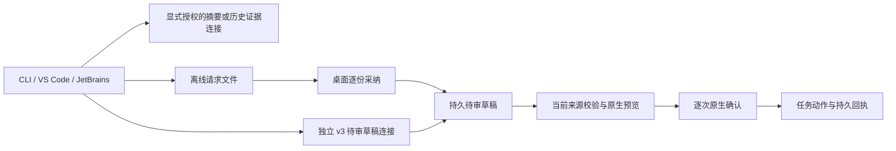

# 目标草稿互通、演化存储与发行边界（2026-10-18）

## 核对范围

2026-10-20 发行回读：CLI **0.166.107** 与 Session Core **0.3.20** 已通过 GitHub Actions OIDC 公开发布，源码为 `6775d7a2deb093ec1979430fa63d61d7b1fc8705`。完整 CLI CI / Strict Sandbox 矩阵、公共依赖安装、签名来源及 Windows 安装回读通过。IDE 发行源码 `94429fada419e8f3e01a794516096ea554120556` 的 18 项完整预检和两条标签发布流水线均成功：Open VSX **0.37.152** 与 JetBrains **0.4.169** 均已公开上架，公开下载制品的内容与标签构建一致，两个新插件均推荐 CLI .107。桌面与产品 .140 仍保持独立发行；下文保留 2026-10-18 的历史核对范围。

本次核对开发源码快照 `f21eac547e`（不在本次远端主线文档基线中），包含 `ddabc1ee3a` 的目标草稿与演化边界合并、`2ceaa84219` 的 Windows ACL 阶段诊断，以及 `4317bf01a4` 的通用编码回归指导。实时公开版本为 CLI **0.166.106**、Open VSX **0.37.151**、JetBrains **0.4.167**。Open VSX .151 推荐 CLI .106；JetBrains .167 仍推荐 .105，.168 的公开上架与下载待核验。CLI .106 / Open VSX .151 的发行提交为 `dca47fd91a209642b6536afd5bc9e99ec74c7d06`，完整 CLI CI / Strict、IDE / ARM64 门和 OIDC 发布成功。开发快照能力不能由相同版本号推断为已发行。

CLI `.105` 的发行提交为 `d4065008bb4eff84cfc09f9361f4ae4e9de2140f`，通过准确提交的 CLI CI、Strict Sandbox 与 OIDC 发布。Session Core **0.3.19**、Context/Memory Kernel **0.1.10**、Agent SDK **0.2.15**、PDH **0.4.65** 独立发行。新目标连接所需的 Session Core 公共出口仍是未发布源码；复用旧子包版本不能发行新增能力。Desktop / Android / iOS 仍从产品 **v5.0.3.140** 单独下载，未包含本轮全部开发快照更新。

## 目标与草稿架构

CLI 文件目标与桌面 SQLite 项目目标保留各自存储和权限。`cc goal catalog` 分页选择目标，`cc goal panels` 读取已授权插件面板；桌面通过独立的本地连接开放一个明确目标，插件不能由目标 ID 任意访问其他项目。

摘要、历史证据、离线采纳与在线待审连接使用不同能力。历史证据只投影有界元数据，不包含任务正文或审批权；SQLite 读取使用 `query_only`，缺表、最新检查不完整或来源变化均显式报告不可用，不能回退旧成功记录。

离线 `draft-request` 导出不可信的说明修改请求；16 KiB 信封内的正文最多 8192 UTF-8 字节。桌面采纳与 pending 入队在同一事务提交，采纳本身不修改任务，也不创建执行意图。重复请求复用记录，冲突正文拒绝覆盖；撤销递增记录 epoch，重新导入不能恢复旧授权。

在线 v3 连接独立授权，持久 grant 绑定 actor、store、project、goal、插件完整身份、声明 digest 与 epoch。CAS 防止迟到的授权覆盖撤权。HTTP 使用双向 HMAC，正文 hash 纳入请求签名；传输校验不等于插件代码身份认证。在线端口仅保存待审草稿，不提供 prepare、approve 或 execute 权限。

客户端发送前持久保存不含正文、凭据的请求引用。网络中断后用 `draft-receipt` 查询同一引用，不自动重发；`not-found` 只代表查询时未观察到记录，不能证明迟到请求不会保存。原生预览和执行前重验来源、授权与转换 digest；撤权后已完成动作仍按原业务权限回读。

## 看板动作与演化存储

看板动作沿用持久审批、恢复和动作回执。`board-task-label-source.js` 保留标签来源；更新通过共享契约和写入 authority 检查，避免编辑操作丢失原标签语义。

演化 ledger 增加物理状态与 manifest 状态 reader，重验 journal、witness、分段历史、manifest head 及 artifact index 的一致性。不能把索引存在或缓存命中当作证据有效；摘要、状态或来源不一致时阻止继续。此轮收紧存储边界，不改变自动晋升 **HOLD**，也不构成真实效果实验结论。

## Windows 启动诊断

私有存储 ACL 检查输出固定阶段名和有界单调耗时，例如 `initialize`、`traversal`、`verify`；不输出路径或凭据。`windows-acl-progress-probe.mjs` 不调用模型，保留每个 ACL 进程原有 60 秒诊断预算与准入检查。对未变化 DACL 避免重复传播，仍保留修复后的校验和遍历保护。

该阶段诊断源码已纳入该开发快照，但未进入 `.105` 或本轮 `.106` 发行树，也不能据此宣称 Windows JetBrains 原生启动超时已解决。诊断观察、CLI 发行门和真实宿主任务结果分别记录。

## 评测与发布状态

公开 `.105 / .150 / .167` 补测已收齐生成 **20/20** 和独立验收 **20/20**，新增 **6** 项候选及全流程通过。累计合格交付 **31/45**，其中普通任务 **26/36**、首次任务 **5/9**，仍有 **14** 项未合格。`COMPLETED` 仅表示该轮证据完整；累计来自多个版本和多次尝试，不是 `.105` 单轮成功率。保留原失败和清理失败证据；剩余样本应使用核验后的新公开包补测。

上述任务补测与正式付费准入、完整 native review、长期验收及 RRSI 真实效果实验分别记账。预算准入仍 **NOT_PAID_READY**，完整 native review **NOT_ADMITTED**，自动晋升 **HOLD**；不得将这些状态合并为“36+9 未执行”或“45/45 通过”。

目标互通的本地验证包含 SQLite、真实私有 DACL、loopback HTTP 和包出口探测；Electron 登录、窗口、原生对话框及部分 IDE 界面使用替身，未完成真实 GUI / 独立业务效果验收。各批次测试有重叠，不能累计报告总数；历史快照中的“未提交”描述保留当时含义，源码现已由本地快照的 Git 合并承接。

发布新增出口时先发布所需子 npm 包，再发布 CLI，最后发布 IDE；各阶段要求准确提交完整配置的跨系统门、GitHub Actions OIDC 和公开制品回读。此次文档与网站部署不发布这些软件包。

## 来源与相关文档

- [公开版本与补测核对收据](https://github.com/chainlesschain/chainlesschain/blob/main/docs/research/cli/evidence/documentation-release-status-2026-10-18.json)
- 开发快照内的原始记录：`docs/research/agents/dots-muse-mods-implementation-progress-2026-10-07.md`，及该快照 `evidence/dmm-cli-online-drafts-2026-10-18`、`dmm-cli-draft-handoff-2026-10-18`、`dmm-cli-project-evidence-2026-10-18` 下的逐批收据；未随本次远端文档变更公开。
- [用户升级指南](https://docs.chainlesschain.com/chainlesschain/cli-ide-update-2026-10-18.html)
- [目标草稿使用指南](https://docs.chainlesschain.com/chainlesschain/goal-drafts-current.html)
