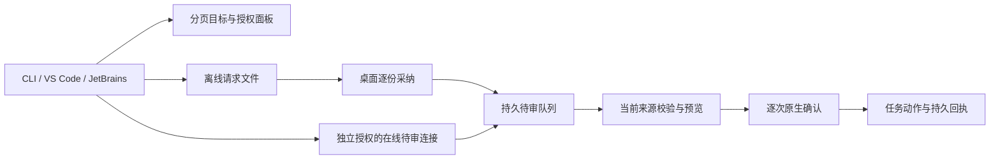

# CLI .107、IDE 公开配对与诊断预算边界（2026-10-20）

## 代码与发行范围

文档核对基线为 `main@38bafe042e`，结合最近 Git 合并记录和公开制品回读。CLI **0.166.107**、Session Core **0.3.20**、Open VSX **0.37.152** 与 JetBrains **0.4.169** 已公开，两个 IDE 均推荐 CLI `.107`。Microsoft Marketplace 未发行。

| 发行面                         | 精确源码                                   | 验证范围                                                |
| ------------------------------ | ------------------------------------------ | ------------------------------------------------------- |
| CLI .107                       | `6775d7a2deb093ec1979430fa63d61d7b1fc8705` | 三平台 CLI CI、Strict Sandbox、OIDC、公开安装与签名来源 |
| Open VSX .152 / JetBrains .169 | `94429fada419e8f3e01a794516096ea554120556` | 完整 IDE 宿主门、不可变标签发布与公开制品回读           |
| 原生产品 v5.0.3.140            | `f733f92cb953fffaafea9f91024bbf1c8846406d` | 桌面、Android、iOS 独立产品发行                         |

IDE 发行提交不属于当前文档基线的祖先；它修正发行元数据与前置检查，不改变插件运行时代码。文档基线、CLI 源码、IDE 源码和原生产品必须分别记录。

## 目标草稿互通

`ddabc1ee3a` 合并的目标目录、授权插件面板、离线请求、在线待审草稿、回执及共享契约已进入 CLI .107 / Session Core .20 和本轮 IDE。桌面新增能力仍要求匹配源码构建，不能推断为产品 .140 已包含全部新面板。

摘要、历史证据和待审草稿分别授权。CLI 文件目标与桌面 SQLite 项目目标保留独立存储。在线 grant 绑定 actor、store、project、goal、插件身份、声明摘要与 epoch，CAS 阻止迟到授权覆盖撤权。HTTP 使用双向 HMAC 和正文摘要；传输签名不证明插件代码可信。

离线正文最多 **8192 UTF-8 字节**，信封最多 **16 KiB**；目录及来源分页最多扫描 **20** 个候选。采纳与入队在同一事务完成，重复请求复用原记录，冲突正文拒绝覆盖。待审连接只能保存建议，不提供批准或执行权限。

发送前持久保存不含正文和凭据的请求引用。结果未知时查询同一引用，不自动重发。`not-found` 只表示查询时未观察到记录，不能证明迟到请求不会保存。执行前重新验证来源、授权与转换摘要；任务修改仍需桌面预览和逐次原生确认。

## 演化存储与看板动作

看板更新保留标签来源，沿用共享契约、authority 检查和持久动作回执。演化 ledger 重验物理状态、manifest head、journal、witness、分段历史与 artifact index；索引存在或缓存命中不能替代证据一致性。源码边界收紧不代表真实效果实验通过，自动晋升保持 **HOLD**。

## Live diagnostics 与正式预算隔离

最新提交 `6775d7a2de` 在 `runNativeCampaign` 和 `runPublicVSCode` 入口首先调用 `requireUnscopedModelTransport()`。存在正式预算 provider scope 时，在解构参数、读取凭据、创建证据目录、下载制品、启动宿主或调用模型之前拒绝执行，避免诊断传输绕过正式预算托管链。

这两个入口是独立 live diagnostics，不能通过继承正式 scope 获得付费评测准入。应使用各自明确确认的诊断流程；正式任务必须通过原有可信预算入口。此修复不发起新模型任务，也不改变正式预算的 **NOT_PAID_READY** 状态。

## Windows 启动诊断

CLI / Session Core 发行承接 `2ceaa84219` 的有界 ACL 阶段诊断。固定阶段名与单调耗时用于定位 initialize、traversal、verify，不输出路径或凭据；单个 ACL 进程保留原有 60 秒诊断预算及清理约束。这些代码和宿主门通过不证明历史 Windows JetBrains 原生任务超时已经解决。

## 验证与仍待完成的验收

CLI 准确提交的 [CLI CI](https://github.com/chainlesschain/chainlesschain/actions/runs/39295248973)、[Strict Sandbox](https://github.com/chainlesschain/chainlesschain/actions/runs/39295259914) 与 [OIDC 发布](https://github.com/chainlesschain/chainlesschain/actions/runs/39315709208) 成功。IDE [完整发行门](https://github.com/chainlesschain/chainlesschain/actions/runs/39322021242) 为 18 成功、1 条件跳过；[Open VSX](https://github.com/chainlesschain/chainlesschain/actions/runs/39326212411) 和 [JetBrains](https://github.com/chainlesschain/chainlesschain/actions/runs/39326213042) 发布成功。JetBrains update `1198232` 已批准、上架且非隐藏，公开 ZIP 的有效载荷与标签制品匹配。

本轮没有新的模型任务补测。历史 `.105/.150/.167` 补测保留生成和独立验收各 **20/20**，新增候选及全流程通过 **6** 项；跨版本累计合格交付 **31/45**（普通 **26/36**、首次 **5/9**），剩余 **14** 项。该累计值不是 .107 单轮成功率。

正式付费准入 **NOT_PAID_READY**、完整 native review **NOT_ADMITTED**、自动晋升 **HOLD** 分别记账。目标互通的 SQLite、授权和 loopback 回归不能代替真实 Electron GUI、独立业务效果或长期验收。文档站部署也不等于重新发行软件包。

## 来源与相关文档

- [本轮公开状态与制品摘要](https://github.com/chainlesschain/chainlesschain/blob/feature/docs-sites-20261020/docs/research/cli/evidence/documentation-release-status-2026-10-20.json)
- [升级与故障排查](https://docs.chainlesschain.com/chainlesschain/cli-ide-update-2026-10-20.html)
- [目标草稿操作指南](https://docs.chainlesschain.com/chainlesschain/goal-drafts-current.html)
- [10 月 18 日历史架构与补测边界](./release-runtime-update-2026-10-18.md)
