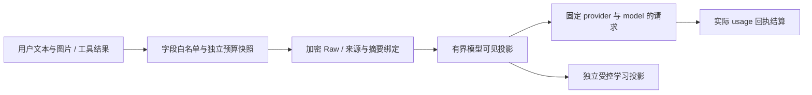

# CLI .117：Evolution 输入、图片预算与工具轮次恢复（2026-10-23）

## 代码与公开发行基线

本轮文档核对 `main@57fd80d530`，结合 Git 首父提交记录、运行时代码和公共制品回读。合并历史中的等价修正保留原有证据范围；功能变化以当前源码及发行树为准。

| 发行面                           | 公开版本            | 精确发行源码                               | 核验结果                                                                       |
| -------------------------------- | ------------------- | ------------------------------------------ | ------------------------------------------------------------------------------ |
| CLI                              | **0.166.117**       | `00e638dd71e7ffa69d2ff366d85f1d209fd38877` | 三系统 CLI CI、Strict Sandbox、OIDC、公共安装及来源核验通过                    |
| Open VSX                         | **0.37.159**        | `ab31677d6691b4fdd5390e16fae60de5a5895cf1` | 完整宿主门禁通过；公开 VSIX 与不可变候选一致                                   |
| JetBrains                        | **0.4.176**         | `ab31677d6691b4fdd5390e16fae60de5a5895cf1` | 六宿主、JDK 21、构建及兼容性门通过；公开 ZIP 的版本与编译后 CLI 推荐值通过回读 |
| Session Core / Personal Data Hub | **0.3.22 / 0.4.66** | CLI 发行依赖树                             | 已先于 CLI 发布并核验公共依赖安装                                              |
| 原生产品                         | **v5.0.3.140**      | 独立产品发行树                             | 继续独立安装、授权与验收                                                       |

两个 IDE 均推荐 CLI **0.166.117**。JetBrains update **1200483** 当前为 `approve=true`、`listed=true`、`hidden=false`。其公开 ZIP 已下载并检查描述符及 `CliVersionCheck.RECOMMENDED_CLI_VERSION`；本机 GitHub API 凭据失效导致 Actions ZIP 的补充下载未完成，未声明该 ZIP 与 CI 制品逐字节相同。Microsoft VS Code Marketplace 仍未发行，原版 VS Code 可安装 Open VSX 的版本化 VSIX。

主要 Git 变化包括：`af297c192c` 的本机签名与 Web Chat 恢复，`dabf15d5d6`、`516b29c6c5` 的工具证据 JSON 兼容和旧输入规范化，`3b1fbaf5f7` 的演化标识误触敏感模式修复，以及 `ca64ea9009` 的输入、输出、图片与耐久恢复边界。`33f1cfc204` 对齐子包源码与公共版本，`ab31677d66` 修复 IDE Doctor 的过期版本断言。未发布的 CLI `.116`、IDE `.158/.175` 标签保留历史状态。

## 统一输入与证据投影

Agent 请求沿用受认证的 Evolution composition，先创建有界快照，再进入 Raw、模型可见和学习投影。v4 Agent 投影规则将图片载荷从文本预算中分离，并为完整模型可见 JSON 保留结构开销。

`evidence-json-text.js` 对允许的代码工具字段和结果执行词法识别，保留 Python/JavaScript 代码字面量。真正的 JSON 仍拒绝重复键、歧义、非安全数值及深度或节点超限。工具完成结果只进入已声明字段，结果与 call ID 配对；未知或不完整字段不能借用其他调用的身份。

## 文本、图片和 token 的不同预算

| 边界                         | 当前值                          | 实现语义                                                    |
| ---------------------------- | ------------------------------- | ----------------------------------------------------------- |
| Agent 文本输入快照           | **1 MiB**，32,768 节点，深度 24 | 图片 base64 载荷不计入文本字节                              |
| Agent 模型可见投影           | **896 KiB**                     | 在输入上限内预留结构与元数据开销                            |
| 文本自动压缩压力点           | **768 KiB**                     | 在投影上限前尝试 canonical compaction；仍执行请求级窗口规划 |
| CLI / IDE 单条输入图片数     | **8 / 4**                       | CLI 与编辑器各自保留入口准入上限                            |
| 单条消息图片原始字节合计     | **20 MiB**                      | 单张图片也不得超过该边界                                    |
| 一次模型请求图片原始字节合计 | **40 MiB**                      | 汇总本次实际请求中的图片                                    |
| canonical 请求载体           | **56 MiB**                      | 覆盖图片 base64 扩张、文本及协议头                          |
| 工具结果预览                 | **最多 50,000 字符**            | 配置可进一步收紧；包含预览结构和元数据，保留完整 JSON 值    |
| JSONL 单事件记录             | **16 MiB**                      | 传输与持久事件限制继续独立执行                              |

视觉规划为普通图片预留 **8192 token**，`detail=low` 预留 **1024 token**。这是请求规划预留；服务商返回的实际 input/output/cache usage 决定真实消耗与费用。模型的视觉能力、上下文窗口及服务商自身限制继续生效。

## 有界输出与中断恢复

`tool-result-preview.js` 对大叶子内容做明确省略，并将最终 JSON 的结构、元数据和省略说明共同计入上限。预览保持可解析；原始输出身份由宿主持有，省略内容不构成完整输出证据。调用方应按字段、关键字或 `offset/limit` 缩小后续读取。

`headless-stream.js` 在 ingress 或其他异常退出前尝试 repair/settle 已完成工具轮次，保留已发生的工具结果和真实失败。过期 CAS、实际并发 writer 或失效 authority 仍停止继续执行，刷新会话和重新读取权威状态后再恢复。恢复不会重新授权工具，也不证明外部副作用已回滚。

## 图片消息包与会话备份

`message-bundle-store.js` 在明确持久会话中将较大图片消息载体保存到会话根下的私有 `.context-message-bundles-v1`，JSONL 记录绑定 generation、字节数和摘要。读取、恢复、删除与落盘确认遵守同一身份和完整性校验。内联边界为 **4 MiB**，单 blob 上限为 **56 MiB**。

备份和迁移应同时保存会话 JSONL、消息包目录及相应权限。仅复制 JSONL 无法保证还原已外置的图片。`persist:false` 不创建这类耐久消息包；图片外置也不放宽单条 JSONL 事件或模型端的限制。

## 本机模型配置与 Web Chat

本轮承接 CLI `.112` 之后的配置恢复：保存的 provider、endpoint、文本/视觉模型和本机签名密钥路径在恢复时按当前配置解析，Gemini/Anthropic 沿各自协议处理，Ollama 地址按既有规范化边界处理。Web Chat 的失败、停止和恢复保留对应状态，受治理错误不能变成降级成功。此接线修复不授权客户端更换宿主 composition，也不提供生产 KMS/PKI 或演化晋升资格。

## 发行门禁、公共回读与验收边界

- CLI 精确源码的 CLI CI **71** 项作业成功，唯一可选发布预演跳过；Strict Sandbox **6** 项成功，覆盖配置中的 Linux、Windows、macOS 单元。
- 子包先通过 GitHub Actions OIDC 发布；13 个子包及 CLI 共 **14** 个公开压缩包通过完整性与身份核验。独立 registry-only 安装核对了 CLI 可执行文件、直接依赖、SQL.js binding 及签名来源。
- Open VSX 标签发布的 **11** 项必需作业成功；JetBrains 的 **13** 项必需作业成功。相反发行渠道的条件跳过不计为成功单元。
- 本轮没有新增真实模型任务验收。历史跨版本合格交付仍为 **31/45**，其中普通 **26/36**、首次 **5/9**，剩余 **14** 项；该累计值不代表 `.117` 的单轮成功率。
- **NOT_PAID_READY**、**NOT_ADMITTED** 和自动晋升 **HOLD** 分别保留；网站部署记录与 npm/IDE/原生产品发行记录分别记录。

## 关键源码与文档

- `packages/cli/src/lib/evolution/agent-model-projection.js`
- `packages/cli/src/lib/evolution/evidence-json-text.js`
- `packages/cli/src/lib/evolution/evolution-evidence-projector.js`
- `packages/cli/src/lib/tool-result-preview.js`
- `packages/cli/src/lib/image-token-estimate.js`
- `packages/cli/src/lib/context-memory-kernel/message-bundle-store.js`
- `packages/cli/src/runtime/headless-stream.js`
- [发布回执](https://github.com/chainlesschain/chainlesschain/blob/main/docs/research/cli/evidence/release117-public/publication.json)
- [用户输入与会话恢复指南](https://docs.chainlesschain.com/chainlesschain/agent-input-and-recovery.html)
- [CLI / IDE .117 升级指南](https://docs.chainlesschain.com/chainlesschain/cli-ide-update-2026-10-23.html)
- [10 月 20 日目标草稿和诊断边界历史](./release-runtime-update-2026-10-20.md)
