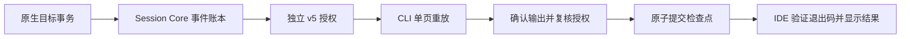

# CLI .142：目标事件、历史恢复与组合交付场景

## 源码与发行身份

本次按已合并的 `main@4ddbde1227543f6cf3f27919cc92f7f8126f9fdf`、实际源码和发行记录核对。
CLI **0.166.142**、Session Core **0.3.25**、Open VSX **0.37.178**、JetBrains **0.4.195** 的不可变源码均为
`b78cf0af8c8b0491189465773b148ac77c332222`。npm/IDE 标签、文档部署提交和客户端源码分别记录。

| 组件                        | 状态                                                                          |
| --------------------------- | ----------------------------------------------------------------------------- |
| CLI .142 / Session Core .25 | Actions OIDC 已发布，独立公开字节与签名来源回读通过                           |
| Open VSX .178               | 已公开，公开 VSIX 已由正式发布流程核验，推荐 CLI .142                         |
| JetBrains .195              | 官方上传成功，商店已批准并列出，推荐 CLI .142；公开 payload 核验单独归档      |
| 当前公开客户端              | v5.0.3.144，沿用既有独立发行身份                                              |
| 客户端候选                  | v5.0.3.145，源码 `93917e15d6fd65a4a0147f2e5b5aace1bc87294a`，尚未完整公开发行 |

实现来自 `f70dfffe75` 的事件观察与恢复、`4032b29349` 的组合场景，发行准备经 PR #534 / #535 合入。
产品门禁要求 npm 包目录与不可变 CLI 源码一致。用户已授权本次客户端在核验 JetBrains 官方上传后先行发行，不等待商店审核；其他构建和制品检查保留。

## 观察与历史分开授权

v1–v3 连接不会因升级获得事件或历史权限，v4 与 v5 也不互相扩权。

| 入口                         | 来源与行为                                             | 边界                                       |
| ---------------------------- | ------------------------------------------------------ | ------------------------------------------ |
| 独立 CLI `goal watch`        | 显式轮询固定目标和存储，输出状态摘要                   | 不回填历史，可能遗漏两次轮询之间的变化     |
| 桌面 v4 `goal.events`        | 独立原生确认，观察最近风险检查与最近 20 条动作回执摘要 | 不授予目标正文、目录、面板、草稿或历史读取 |
| 桌面 v5 `goal.event-history` | 独立原生确认，读取接入后的持久事件账本                 | 不授予实时观察或写入，不补造旧版本历史     |

观察每轮及输出前核验原生授权、插件准入和源快照。断连、撤权、到期、身份或目标版本变化会停止读取。
观察时间与原生事件记录时间不同；记录和回执都不证明目标完成。

## 事务账本与检查点

账本保留每个 actor/goal 最近 1000 条接入事件，去重 ID 集合最多 4096 条。游标带签名、链式绑定和目标/身份约束，本身不授予权限。
单页最多扫描 20 条、返回 16 KiB。未接入账本的执行路径、旧客户端写入和此前历史不回填。

CLI 在严格文件锁内读取检查点，确认 stdout 输出后再检查当前原生和插件权限，随后 fsync 并原子替换。
**退出码 0 表示检查点已提交。** 输出后、提交前崩溃可能重复相同事件 ID，因此保证为至少一次交付；stdout 接受不证明下游消费。
`new` 拒绝已有文件，`resume` 拒绝缺失文件，默认 `auto` 保留显式 CLI 的创建或续用行为。

历史淘汰通过截断信息或 `GOAL_EVENT_HISTORY_GAP` 暴露；数据库恢复导致游标超前时返回 `GOAL_EVENT_HISTORY_REGRESSED`。
身份、目标 revision/control generation 或插件声明变化需要显式重新选择，缺口、回退和绑定异常不自动重置。

## 两端 IDE 的恢复边界

VS Code 的 `goal-history.js` 与 JetBrains 的 `GoalHistoryReplay.java` 通过原生选择器获取连接、目标 ID 和检查点路径。
IDE 不打开凭据或检查点正文，拥有并取消其 CLI 子进程。成功退出且完整协议校验通过后才显示提交结果；每次点击只读一页。
续读使用宿主保存的原始绑定，webview 不能替换路径或目标。刷新、插件变化和关闭使旧结果与续读失效。
取消后保留检查点，提示它可能已经推进；没有自动重试、重连或持续翻页，也不宣称取消回滚。
新的原生历史入口需要匹配的新版桌面客户端，公开 product144 不构成该入口的覆盖证据。

## 最小组合交付场景

`project-delivery-assistant` **0.2.0** 是数据声明包，组合已有证据、事件、历史和待审描述提议，不增加代码执行入口。
CLI 区分全部实现能力与当前命令/连接的激活能力：仍检查整份声明的兼容、信任和同意，再于 reader/queue 回调前检查当前操作权限。
空激活集合不回退成全量能力，摘要连接不会因组合包声明其他能力而扩权。

当前接通三种事件、摘要/证据面板和描述提议六项能力，未接通 `task.create`。
禁用、卸载和重装保留既有引用、原生目标与历史规则；重装不承诺清空全部信任或同意，也不会自动读取。
自动起草、自动创建或执行任务、完整调度助手和独立业务效果仍未完成。

## 验证与剩余工作

- 准确 npm 源码的 CLI CI：75 项成功、1 项可选 dry-run 跳过；Strict Sandbox：6/6 成功，覆盖配置的三个操作系统。
- npm OIDC、独立公开回读和两款 IDE 官方发行分别记录；IDE ARM64 11/11 成功。
- DMM 工程批次分别保留 399 项、230 项、245 项通过及相应跳过范围，不与发行作业或彼此混算。
- 客户端候选工作流 `41961242898` 尚未完整成功，不能用部分平台构建推断五平台发行完成。
- 真实 DMM GUI、独立业务效果、默认关闭/灰度策略、迁移和回退演练仍需验收，发行不完成整个 DMM 计划。

本轮没有新增付费模型任务评测。历史 Sol 原冻结 **41/45**、跨版本且含修正项目的累计 **45/45**、独立修正四项 **2/4**，以及火山修正轮生成 **39/45**、严格 **24/45**、历史累计 **36/45** 保留各自范围。
工程检查不新增模型验收，NOT_PAID_READY / NOT_ADMITTED / HOLD 保留。

## 源码、回执与部署

- [CLI 目标命令](https://github.com/chainlesschain/chainlesschain/blob/b78cf0af8c8b0491189465773b148ac77c332222/packages/cli/src/commands/goal.js)
- [插件能力表](https://github.com/chainlesschain/chainlesschain/blob/b78cf0af8c8b0491189465773b148ac77c332222/packages/cli/src/lib/plugin-runtime/cli-goal-capabilities.js)
- [发行记录与独立回读](https://github.com/chainlesschain/chainlesschain/blob/main/docs/research/cli/evidence/release142-public/README.md)
- [用户升级指南](https://docs.chainlesschain.com/chainlesschain/cli-ide-update-2026-11-05-142.html)
- [客户端候选发行](https://github.com/chainlesschain/chainlesschain/actions/runs/41961242898)

权威源为本文件，两站同步脚本生成副本。官网由同一状态快照驱动中英文页面，构建后校验归档哈希和页面数量，服务器保留备份并支持失败回滚。
线上源码以三个站点各自的 `/deployment-source.json` 为准，本地构建成功不能替代公网回读。
