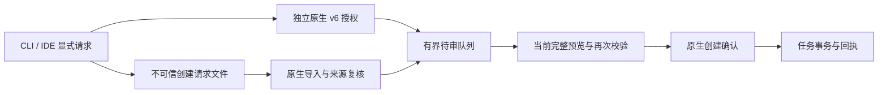

# CLI .143：本地算力配置与受控任务创建草稿

## 源码与公开发行

本轮按 Git 中 `a527352f32` 的实现、`6175da0ffe` 的宿主最低版本修正和后续协议/诊断修复核对。
实现经 PR #537 合入 `main@248e5b3f3f36467c1972d8aa0a094e29e44fd331`；公开 npm 与 IDE 的不可变源码为
`3fa3a4b258bbcb60b23b4298cec375661ad6f410`。发行回读文档基线为 `d2070ce914af8d675191e3492e0ce7db650c79c3`。
本次网站部署提交另记于各站 `/deployment-source.json`，不替换运行时制品身份。

| 组件                                | 已核验状态                                                                    |
| ----------------------------------- | ----------------------------------------------------------------------------- |
| Session Core 0.3.26 / CLI 0.166.143 | 子包先行、Actions OIDC 发布，独立公开字节与签名来源一致                       |
| Open VSX 0.37.179                   | 公开、列为 latest、可下载；VSIX 与官方制品字节一致，推荐 CLI .143             |
| JetBrains 0.4.196                   | 更新 1213983 已获批、上架并可下载；627 个原始 payload 文件一致，推荐 CLI .143 |
| 原生产品 v5.0.3.145                 | 已独立公开，22 个资产；源码 `93917e15d6fd65a4a0147f2e5b5aace1bc87294a`        |

产品 .145 来自较早源码，不包含本批新增原生 v6 创建与模型起草实现。CLI/IDE 的公开升级不自动升级已安装桌面端，也不代替原生功能 GUI 验收。
签名、公证和商店分发按产品独立回执理解，下载制品可用性不替代商店上架证明。

## 本地算力连接与凭据身份

VS Code 与 JetBrains 的“配置大模型”增加独立 **Local compute / OpenAI compatible** 选项。
力数、vLLM、SGLang 等使用 CLI `custom` provider 的 Chat Completions 路径，显式绑定 Base URL、平台 API 模型 ID、可选平台密钥和 HTTP 许可。
界面名称不推断模型 ID、工具能力或视觉能力；局域网 HTTP 必须由用户明确允许。

IDE 原生宿主经 stdin 把敏感配置交给实际使用的 CLI，CLI 原子保存后读取脱敏配置确认。
密钥不进入 IDE 设置或子进程 argv。更换为新的无密钥端点时，不沿用旧端点的已配置凭据；保留同一端点密钥与更换端点是不同操作。
“测试已保存连接”会发送一次真实请求，由用户显式触发；运行中的任务保留其已捕获的连接身份。

IDE 新入口配置聊天/CLI 连通性。桌面模型草稿有单独的治理、资料选择和逐次原生确认流程，不能由保存 IDE 配置直接启动。

## 文件请求、在线 v6 与原生创建

`goal draft-create-request` 导出新的不可信请求文件，不覆盖既有文件，不写入业务任务。
请求明确选择目标、原生风险提议来源、插件/作用域、稳定 request ID、任务类型、标题和 UTF-8 描述文件；描述上限 8192 bytes。
桌面导入时重新核验来源和目标身份，不能把文件里的声明当作权限。

在线路径通过 `goal draft-create-access` 提供插件标签，供桌面另行原生授权。v6 授权与既有摘要、事件、历史、说明草稿授权分开；旧连接不会因升级获得任务创建权限。
请求保存到 pending 后仍需当前完整预览、来源/插件/授权复核及原生创建确认。已保存草稿、回执或模型输出都不证明任务已创建或目标已完成。
转换与恢复保留请求身份；结果未知时查询原请求，不自动重发，也不通过换 ID 绕开重复处理边界。

## 数据声明组合场景 0.3.0

`project-delivery-assistant` 0.3.0 声明已有三类事件、证据面板、说明提议及 `proposal:task.create`。
最低宿主分别为 CLI `>=0.166.143`、VS Code `>=0.37.179`、JetBrains `>=0.4.196`。
它是数据声明包，不增加任意代码入口；安装不会自动读取资料、创建或执行任务。
完整声明仍需兼容、信任与同意检查，当前操作只激活需要的能力，空集合不回退成全部声明能力。

## 逐次授权的桌面模型草稿

`ProjectGoalModelDrafts` 持久化 actor/goal/request 身份及准备、发送、保存和失败状态。每个耐久请求只允许一次已确认的模型调用，崩溃或未知结果不自动重试。
说明修改与任务创建建议复用受治理的 manager/client 入口，并在模型调用前复核明确选择的目标、来源、模型身份和资料范围。

Memory 是单独选择的资料能力；确认前、输出读取和后续预览/采纳继续核验授权。撤权使尚未确认的派生草稿失效，但不能收回已经发给供应商的资料。
外部 OpenAI 兼容/火山适配器最多 512 输出 tokens、30 秒总期限；既有本机 Ollama 上限为 2048。有限 token/费用预算在无法满足治理条件时于发送前拒绝，未知费用不按零处理。
治理后的结果只进入 pending；业务任务的写入继续由原生预览与确认控制。

## 验证证据与限制

- 准确发行源码的 CLI CI 76/76、Strict Sandbox 6/6 成功，覆盖配置的 Linux、Windows、macOS；正式 npm 与两款 IDE 工作流均成功。
- CLI 和 Open VSX 公开制品字节一致；JetBrains 比较全部原始文件及解压后的嵌套 JAR 内容，排除 ZIP 容器元数据，两个归档哈希分别保留。
- 两个合成真实火山草稿共使用 1176 tokens，费用未知；它们不是独立业务效果评测，本次网站更新不新增模型请求。
- 力数只读发现连接曾返回 `ECONNRESET`，真实力数推理、这批特性的真实 IDE/Electron GUI、业务效果及迁移/灰度回退仍待独立验收。

历史 Sol 原冻结 41/45、含修复项目的跨版本累计 45/45、独立修正四项 2/4，以及火山修正轮生成 39/45、严格 24/45、历史累计 36/45 分别保留。
本次发布和文档检查不新增模型任务通过数；NOT_PAID_READY / NOT_ADMITTED / HOLD 保持原范围。

## 源码与操作入口

- [CLI 目标命令](https://github.com/chainlesschain/chainlesschain/blob/3fa3a4b258bbcb60b23b4298cec375661ad6f410/packages/cli/src/commands/goal.js)
- [组合场景声明](https://github.com/chainlesschain/chainlesschain/blob/3fa3a4b258bbcb60b23b4298cec375661ad6f410/packages/cli/src/lib/plugin-runtime/examples/project-delivery-assistant/plugin.json)
- [桌面模型草稿实现](https://github.com/chainlesschain/chainlesschain/blob/3fa3a4b258bbcb60b23b4298cec375661ad6f410/desktop-app-vue/src/main/task/project-goal-model-drafts.js)
- [公开发行与制品回读](https://github.com/chainlesschain/chainlesschain/blob/d2070ce914af8d675191e3492e0ce7db650c79c3/docs/research/cli/evidence/release143-public/README.md)
- [用户升级与本地算力配置](https://docs.chainlesschain.com/chainlesschain/cli-ide-update-2026-11-06-143.html)
- [原生产品 .145](https://github.com/chainlesschain/chainlesschain/releases/tag/v5.0.3.145)

本文件为设计权威源。两个 VitePress 站点由同步脚本生成副本；三站从同一已提交文档快照构建、核对归档和页面后部署，保留旧站与回滚入口，最后核验公网源码标记及页面/资源字节。

## 2026-11-07 未发行源码补充

未发行源码进展：PR #539 新增 CLI 目标显式移交到原生个人项目、原字节备份/冻结及签名作废回执恢复。新目标保持暂停，不继承旧权限；需匹配分支的 CLI、Session Core 和桌面构建，公开 .143/.145 尚不包含。 `goal transfer-to-project` 与 `goal restore-transfer` 属于提交 `a2e7f17a03` 所在未发行分支，不属于本页的 .143 公开制品。见[独立设计](./cli-goal-transfer-source-2026-11-07.md)。
