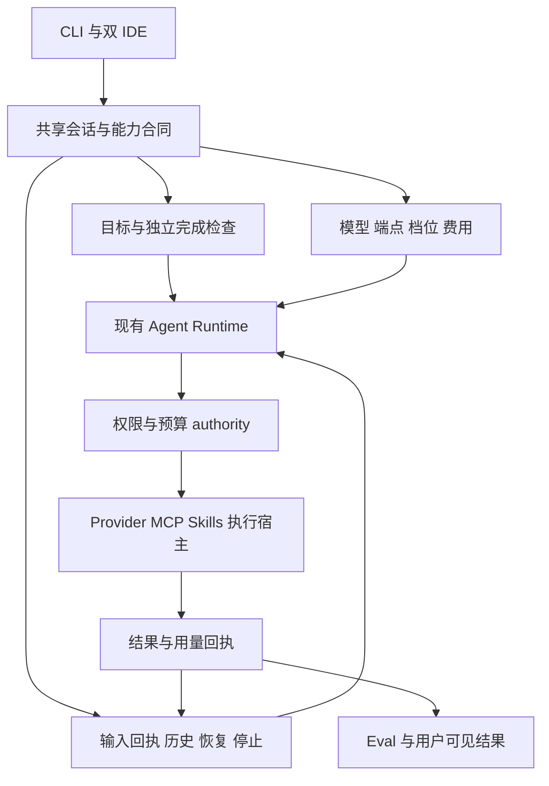
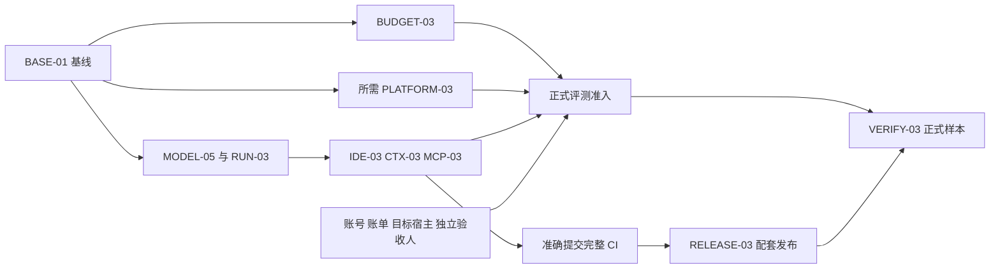
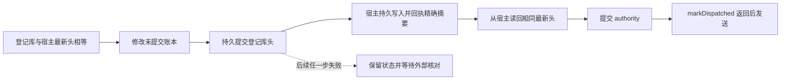

# ChainlessChain 借鉴 Codex 和 Claude Code 的实施计划

日期：2026-10-15。适用范围：CLI、共享 Agent Runtime、VS Code 和 JetBrains 插件。桌面端复用成熟后的共享能力；移动端、论坛和业务后端不纳入本轮改造。

2026-10-27 差距优化：对照最新 Claude Code / Codex 的[复核报告](./cli-ide-codex-claude-gap-review-2026-10-27.md)开始实施 Goal 验收与检查点恢复修复，见[首批实施记录](./cli-ide-goal-completion-progress-2026-10-27.md)。此次为尚未发布的源码变更；公开版本为 CLI `.127`、Open VSX `.165`、JetBrains `.182`，跨版本累计 `32/45` 及剩余 `13` 项沿用独立证据。

2026-10-27 续做：已核验公开 CLI .127、VS Code .165、JetBrains .182 的完整下载字节，生成仅覆盖剩余 13 项、复用已合格 32 项的独立复测计划。找回 verify-09 原始超时请求回执及 provider response ID，确认已派发但没有结束或用量事件，重试前仍须账户核对。工作流前置检查 85 项、派发与收集器检查 27 项通过；本次尚无新增付费模型任务。见[本次续做记录](./cli-ide-recovery-progress-2026-10-26.md#2026-10-27-剩余-13-项复测准备)。

2026-10-26 续做：RUN-03 / IDE-03 新增保存输入删除的附件保护与排队身份复查，见[最新记录](./cli-ide-recovery-progress-2026-10-26.md)；此前管道交付与 Windows 草稿保存见 [10 月 23 日记录](./cli-ide-recovery-progress-2026-10-23.md)。第 28 节保留 10 月 17 日历史快照；后续 CLI .125 发布与跨版本累计 32/45 以最新记录链接的独立证据为准。本轮新增修复尚未发布，没有新增正式模型任务。

**实施状态：已交付首轮工程改动、火山引擎真实诊断及后续预算接线、出口审计、独立谱系登记、物理身份、宿主检查点接线和部分任务可控出口边界；整份计划尚未验收完成。** 首轮记录见[第 10 节](#10-首轮实施记录2026-10-15)，预算作用域、适配器及登记库见第 11～17 节，逐项最新状态见[第 28 节](#28-工作包当前完成情况2026-10-16)。正式评测保持 `NOT_RUN`，共享预算 `paidReady:false`，native `NOT_ADMITTED`，晋升 `HOLD`。

建议未来八周优先投入六件事：**模型能力与费用同步更新、任务完成与恢复可靠、首次安装容易排障、上下文按需加载、扩展接入行为一致、真实任务有独立验收**。项目已经有较完整的 Agent、Skills、MCP、Memory 和 IDE 基础，下一阶段的收益主要来自把这些能力接成稳定的用户流程。

本计划承接 [CLI 差距分析](./cli/cli-claude-code-codex-gap-analysis-2026-10-05.md)和 [IDE 差距分析](./ide/ide-claude-code-codex-gap-analysis-2026-10-05.md)，同时按[后续实施记录](./cli-ide-gap-implementation-2026-10-05.md)、[验证记录](./cli-ide-gap-validation-2026-10-05.md)及当前源码调整任务。原报告正文是 10 月 5 日的审计快照，不能直接用作今天的未完成清单。

## 1 现状与本轮目标

### 1.1 实施基线

源码核对基线为 `6752b49e1e068c180a645e1e26773303bbb40648`。10 月 15 日工作区中的发布设计记录（`docs/design/release-runtime-update-2026-10-15.md`）记载 CLI `0.166.101`、Kernel `0.1.10`、Open VSX `0.37.145` 已公开；JetBrains `0.4.163` 仍是源码候选，公开记录为 `0.4.162`。该记录当时尚未提交，正式排期开始时应按 BASE-01 重新固定发布证据。

以下状态决定任务从哪里开始：

| 方向          | 当前可复用能力                                                                                        | 本轮工作                                                                 |
| ------------- | ----------------------------------------------------------------------------------------------------- | ------------------------------------------------------------------------ |
| 模型与定价    | GPT-6.1 Sol、Sonnet 5.5 已有精确 profile；当前源码也已有 Haiku 5.5；价格、reasoning、协议已有共享合同 | 增量维护速度档位、来源日期、网关差异及实际 usage，不重复增加已有模型     |
| 上游更新      | 已有 `Model Catalog Review`、定时审查和漂移报告                                                       | 补充能力字段变化审查，记录从发现到验证的处理时长                         |
| 任务恢复      | 输入接受回执、历史分页、压缩、重试和工作流终态均已有实现；`.101` 修复压缩拒绝后的结算与终态           | 验证跨入口组合场景，统一用户可见的完成、失败、停止和待核对状态           |
| IDE           | Doctor 能力诊断、严格 CLI 身份、120 秒有界初始化、草稿及恢复已实现                                    | 完成公开安装、升级、故障恢复及真人操作旅程                               |
| Skills 和 MCP | Skills 已分描述与正文两阶段加载；MCP 已有阈值工具搜索和发现缓存                                       | 优化选择准确率、默认上下文成本、失效与权限一致性                         |
| Memory        | 已有二级查询索引、过滤下推、稳定游标和重建                                                            | 建立固定硬件 SLO，再优化索引读取和重建成本                               |
| 外部 Codex    | 固定 `0.160.0` 的 schema 与真进程探针已存在                                                           | 更新兼容证据；协议通过与生产执行准入分别管理                             |
| 正式评测      | 36 项任务、9 次首次安装、setup/check 和采集器已有工程基础                                             | 原正式状态仍为 `NOT_RUN`；补齐准入条件后执行，保留固定分母               |
| 预算与平台    | 已有正式预算 authority、受守护传输及部分 native 原型                                                  | `paidReady:false`、完整 native `NOT_ADMITTED` 仍是实际边界；先补对应证据 |

### 1.2 值得学习的产品方法

1. **让完成条件成为任务的一部分。** 用户提出目标后，系统应展示产物、验证结果和剩余问题，持续执行有边界的工作。
2. **让一次任务贯穿 CLI 和 IDE。** 历史、草稿、审批、预算与停止状态由共享 runtime 决定，入口负责呈现与操作。
3. **把上下文作为有限资源管理。** 按任务加载技能、工具和文件，解释上下文与费用的主要来源。
4. **以真实能力决定选项。** 模型名、安装版本和账号权限分别核验，给出可执行的降级说明。
5. **把竞品修复转换为本项目的回归场景。** 优先寻找对应调用路径和复现条件，再决定是否修复或立项。
6. **用真实任务收益判断投入。** 重点看任务通过率、人工接管次数、费用、恢复成功率和首次成功时间。

## 2 最新官方资料带来的增量

官方资料核对日期为 2026-10-15。“最新”在这里指当日可读取的官方能力说明，客户端、模型、API 和 IDE 的版本分别处理。

| 官方信息                                                                                                        | 对本项目的启发                                                               | 对应任务                  |
| --------------------------------------------------------------------------------------------------------------- | ---------------------------------------------------------------------------- | ------------------------- |
| OpenAI 10 月 8 日发布 GPT-6.1 Sol Ultrafast；API 通过 `service_tier` 选择，产品订阅与 API 的可用条件不同        | 将模型、档位、端点、区域和账户可用性共同纳入合同，速度选项应显示相应费用状态 | MODEL-05                  |
| Codex App Server 文档包含持久 goal、分页历史、恢复和独立 session identity                                       | 将目标、终态和历史定位贯穿双 IDE；适配器按固定协议验证                       | RUN-03、IDE-03、COMPAT-03 |
| Codex Skills 文档强调按需加载与初始目录预算；官方提示工程文章建议缩短描述、按任务读取说明                       | 在现有延迟加载上完善目录排序、诊断和检索效果评估                             | CTX-03                    |
| Claude Code 官方 CHANGELOG 当前首项为 `2.1.299`，涉及闲时压缩、usage 提示、重启重复工具调用、队列和插件边界修复 | 借鉴成本提示与恢复负例；闲时压缩先做收益实验；权限相关项先做本项目复现       | RUN-03、CTX-03、MCP-03    |
| Claude MCP 文档描述工具按需发现及不同模型、网关的兼容边界                                                       | 现有工具搜索需结合端点能力、schema 版本和失效机制运行                        | MCP-03                    |
| Claude 最佳实践强调可执行完成检查，并将执行与结果复核分开                                                       | 复用已有完成条件引擎、Eval 和独立 checker，让任务结束有依据                  | RUN-03、VERIFY-03         |

来源：[OpenAI API 更新](https://developers.openai.com/api/docs/changelog)、[Ultrafast](https://developers.openai.com/api/docs/guides/ultrafast-mode)、[Codex 产品更新](https://learn.chatgpt.com/docs/changelog)、[App Server](https://learn.chatgpt.com/docs/app-server)、[Skills](https://learn.chatgpt.com/docs/build-skills)、[提示与技能改进](https://developers.openai.com/blog/rethinking-skills-and-prompts-for-gpt-6-astra)、[Claude 官方 CHANGELOG](https://raw.githubusercontent.com/anthropics/claude-code/main/CHANGELOG.md)、[Claude MCP](https://code.claude.com/docs/en/mcp)、[Claude 最佳实践](https://code.claude.com/docs/en/best-practices)。

版本边界：Claude `2.1.299` 是本次读取的官方变更日志首项，未核验各分发渠道同步情况。原 Codex changelog 地址已跳转到混合产品更新页，本次未从该页确认最新 CLI 补丁号；`0.160.0` 仅表示仓库当前固定探针版本。COMPAT-03 必须先确认目标发行及二进制身份，再更新测试版本。

## 3 架构与交付原则

继续使用现有共享 runtime。新增能力优先扩展已有模型 profile、会话事件、权限 authority、工具目录和验收器，控制独立状态来源的数量。

设计约束：

- 模型声明、账户可用、运行时支持和验收通过分别记录；未知费用继续显示 unknown/unpriced。
- 输入接受状态、执行结果和目标验收结果分别建模。会话读回不触发工具副作用，未知接受状态先核对。
- 执行权限在实际调用前校验，模型、插件描述、历史消息及界面状态均不能自行授予权限。
- 给新增字段加版本与能力协商。旧 CLI 保留已支持功能；无法确认的高级能力明确降级。
- 数据升级保留恢复路径。特别是 Memory 新索引格式可能被旧 reader 拒绝，回滚需要兼容 reader 或备份恢复。

## 4 工作包与验收条件

下列 ID 是本轮计划项；括号中标明与旧报告的关系。人日为工程估算，包含定向回归与文档，不含市场审批、账号开通和长时运行的等待。负责人使用角色，启动时落实到具体人员。

### BASE-01 固定当前能力和发布基线

**优先级：P1；负责人：技术负责人和 QA；工作量：2～3 人日。**

整理一份可机器读取的能力清单，关联源码 SHA、CLI 与子包版本、IDE 版本、OS/架构、执行位置、验证类型和证据路径。复用现有发布回读及执行位置合同，并让旧问题 ID 指向现有实现或后续任务。

验收：

- MODEL-03、MODEL-04、PERF-03、IDE-READY-02、IDE-ONBOARD-02、IDE-COLD-02 标记为已有实现并附剩余验证项。
- 明确公开版本、源码候选和市场待审状态；记录当前 36+9、预算和 native 准入状态。
- 后续每个工作包有确定基线，允许按能力交付；发布状态不会自动关闭产品验收。

### MODEL-05 模型与服务档位统一维护

**优先级：P1；负责人：Runtime 工程师；工作量：5～7 人日；承接 MODEL-03 和 MODEL-04。**

启动基线中 `model-context-catalog.js` 的目录日期为 `2026-10-05`，GPT-6 共用 `serviceMultipliers` 未列出 `ultrafast`；`llm-pricing.js` 对不认识的档位返回未定价。首轮已按精确型号补充档位合同和定价，目录日期更新为 `2026-10-15`；实际账号、官方端点和账单仍单独验收，详见第 10 节。

实施步骤：

1. 在现有 profile 上补充逐型号、逐档位的能力和定价来源，记录 `reviewedAt`、端点范围和未知字段；先核实价格表达是否能由现有倍率准确表示。
2. 将上游审查从版本变化扩展到协议、档位、上下文、缓存、区域和退役字段，输出待审差异与负责人。
3. 串联配置、请求生成、预算预留、usage 结算和双 IDE 显示，保留 requested/effective 档位；以响应证据确定实际结算。
4. 官方端点与自定义网关分别建立合同。按用户配置显式降级或返回错误，避免静默换模型或变更费用档位。

验收：不支持档位在发出请求前给出准确原因；未知价格不能显示为免费；计费、预算、Eval 与 UI 对同一请求一致。真实官方 stream/tool/reasoning 和账单在授权账号下另行验证。

### RUN-03 将目标执行与恢复接成完整流程

**优先级：P1；负责人：Runtime 工程师；工作量：7～10 人日；承接恢复和压缩修复。**

复用 `goal-condition-engine.js`、`workflow-engine.js`、`session-input-receipt.js` 和现有会话存储。完成条件支持确定性检查和独立评价；默认工程任务优先使用测试、构建或产物检查。长期 OKR 与会话完成条件保持各自语义。

实施步骤：

1. 将目标、检查结果、预算和剩余步骤投影到 CLI 与 Workbench，保留现有事件身份。
2. 对齐停止当前轮、停止指定后台任务和停止整个工作流的范围；结果里保留未完成工作与最后可靠检查点。
3. 统一恢复顺序：读取持久状态、核对输入接受回执、恢复有效权限与预算、确认未决副作用，再接受后续输入。
4. 覆盖压缩失败但已经计费、提交未知、断流已输出正文、工具执行后响应丢失、重启同时收到新输入等组合场景。

验收：失败压缩不会把任务标为完成；已知用量只结算一次；未知提交进入待核对状态；没有确认未接受时不自动补发。CLI 和两个 IDE 对同一任务展示相同结果，冻结故障场景无重复副作用。

### IDE-03 优化首次成功与故障恢复

**优先级：P1；负责人：IDE 工程师；工作量：5～7 人日；承接三项 IDE 修复。**

以“安装插件 → 找到正确 CLI → 配置 provider → 完成首次任务 → 查看变更与验证 → 重启继续”为主旅程。复用 Doctor、onboarding、草稿、流式 transcript、Plan/Diff/Review 和 Sessions Workbench。

实施步骤：

1. 在同一位置展示实际 CLI 身份、版本配对、运行位置、模型可用性和能力降级原因，提供对应修复动作。
2. 启动等待显示当前阶段和可停止状态；超时、进程退出、凭据错误和端点不支持分别提示。
3. 提交后明确区分排队、已接受、运行、待审批、停止、失败、完成和待核对；保留问题与审批的结果。
4. 将上下文附件、诊断、产物和验证入口整合到任务视图。用户滚动阅读时保持选区和位置，错误与恢复操作支持键盘访问。

验收：无 CLI、同名 GCC、错误显式路径、旧版降级、30 秒迟到 init、永不 init、提前退出、reload、最后标签关闭等场景均有正确结果。干净 profile 和公开安装产物完成九入口旅程；真人辅助技术验收单独记录。

### CTX-03 衡量并降低无关上下文

**优先级：P1；负责人：Runtime 工程师；工作量：5～8 人日；扩展既有 Skills 和上下文工程。**

Skills 的正文延迟读取与预算已存在，本项重点是让加载决策有效且可解释。MCP 部分与 MCP-03 共用测量口径。

实施步骤：

1. 利用现有 context source ledger 展示系统说明、项目规则、技能目录、工具 schema、历史、附件和 Memory 的占用来源；估算值和真实 usage 分别标记。
2. 审查高频内置技能描述，缩小触发范围，将长流程拆成按需引用；保持显式技能调用和权限要求完整。
3. 对 50、200、500 个技能及大型 MCP 目录测试目录裁剪、检索命中、正文加载时机和错误调用率；被省略内容可搜索、可提示。
4. 保留压缩前后的目标、用户约束、未决审批、关键证据和恢复身份。用中文、代码、emoji、长工具输出及图片任务评估事实保留。
5. 闲时压缩列为实验开关：先估算摘要费用、缓存收益、离开时长及恢复质量，在可核算预算内验证后决定是否启用。

验收：固定任务集上比较默认上下文、请求数、费用与通过率；上下文变小同时必须保持关键约束和权限语义。目录中保留成本提示，失败压缩不替换原有效 head。自动闲时压缩不作为本轮默认行为。

### MCP-03 统一扩展发现与执行边界

**优先级：P1；负责人：Runtime 工程师；工作量：4～6 人日；承接 MCP-02。**

复用 `mcp-tool-search.js`、`mcp-client.js` 和 `plugin-runtime/`，聚焦既有工具搜索、缓存、重载、策略检查与执行的组合行为。

实施步骤：

1. 核验延迟 schema 在各 provider 路径上的实际可调用性，将连接失败、未授权和无匹配结果区分显示。
2. 缓存绑定 server、工具 schema、能力和策略版本；服务器变更或撤销权限后，旧会话中的描述不能继续授予执行能力。
3. 将上游特殊工具名、插件禁用后残留、动态新增 server、挂起通知正文、日志背压等问题转换为针对本项目的负向场景。
4. 保持结果未知时不重放；受限调用在启动服务器或发送网络请求前完成策略检查。

验收：stdio、HTTP、SSE、取消、重连、热重载、策略变更具有一致结果；被拒绝的连接没有实际启动或网络副作用；大输出和日志阻塞能有界终止。外部 OAuth 账号另按目标服务验收。

### BUDGET-03 完成正式评测的费用约束

**优先级：P0 前置门，仅用于正式付费评测与相应支持声明；负责人：Runtime 和平台工程师；工作量：10～15 人日，宿主隔离另计。**

当前 `formal-budget-transport.js` 明确列出 Agent、Chat、压缩、Advisor、探针、重试及子进程出口尚未全部覆盖。本项复用正式预算 authority，先明确覆盖范围，再逐出口接入。

第二轮已为宿主显式启用的进程内调用加入预算作用域，接入 canonical Agent、Chat、压缩、Advisor、探针、Hub 及 stream 适配器，支持流式交付与 EOF 后持久结算。当前仅承接已核验的 OpenAI Chat 合同，未覆盖协议在作用域内拒绝发送。CLI 启动器、SDK、worker、后代出口与宿主隔离仍待验收，正式 gate 保持关闭；详见第 11 节。

实施步骤：

1. 建立请求入口清单与调用链，确保每次付费尝试先预留、后调用、再按可信 usage 结算；压缩和重试进入同一预算。
2. 约束同一评测计划的预算谱系唯一性，覆盖数据库复制、回滚、并发进程、异常退出及恢复。
3. 将凭据与 authority 放在受信任宿主内，验证任务进程和后代无法绕过受控出口。宿主要求与 PLATFORM-03 联合验收。
4. 固定账户价格、币种换算、输入及输出上界和评测窗口；未知账单保留未决预留，暂停后续请求。

验收：重复回执不重复结算；两个并发进程不能各自花完整预算；跨库复制与回滚不能生成额外额度；断线、压缩拒绝和 Stop 后的账本可恢复。全部目标出口和宿主组合通过后，才能调整对应范围的 `paidReady`。

原冻结计划的共享 **$99** 是历史总上限，不能重置为新预算或拆成每次运行各 $99。执行前须核对历史已消费和未决费用；本计划不构成新增付费调用授权。

### PERF-04 将性能数据变成可执行目标

**优先级：P2；负责人：Runtime 工程师和 QA；工作量：4～6 人日；承接 PERF-03。**

Memory 索引已完成，已有测量显示热查询仍要校验索引字节。先按 1K、10K、100K 数据和固定硬件建立基线，再决定是否分段验证、缓存已验证页或调整索引布局。

同时测量 IDE 冷启动、历史分页、长流式响应、Stop 和内存趋势。查询结果、排序和 CAS 一致性是前置条件，性能优化不能放宽损坏检测或读旧权限。

验收：完整报告冷、热、重建、并发写删和损坏恢复；与全量扫描比较相同结果摘要。任何缓存绑定 authority/generation，失效后重新验证；数据回滚路径经过演练。SLO 达标才宣布性能目标完成。

### VERIFY-03 用正式任务检验产品收益

**优先级：P1；负责人：QA 和独立验收人；工作量：8～12 人日，不含外部等待；承接 VERIFY-02 和 VERIFY-IDE-02。**

复用冻结 36 项任务、9 次首次安装及现有 setup/check、IDE prepare/finish、outcome schema。新增竞品回归属于独立工程集，不能加入正式分母替代未运行样本。

执行顺序：

1. 检查验收器独立性、冻结源码和任务规格，保留历史反例及失败证据。
2. 完成账号、目标九入口、公开包身份、预算、宿主和独立人工审阅的准入核对。
3. 从冻结样本中选择少量代表任务先执行，合格后继续剩余任务；已经执行的样本仍归原分母，不额外计数。
4. 采集实际产物、测试、终态、重试、人工接管及逐请求费用，独立判断任务是否达标。
5. 按支持范围安排真实 8h/24h 活跃负载观察、恢复演练和 NVDA/VoiceOver/Orca 听测。

验收：报告固定展示完成数、通过数、失败数、阻塞数和未运行数；区分执行成功与验收通过。对同一任务比较改造前后成本和接管次数，禁止由小样本或测试数量推出超过竞品的结论。缺准入条件时保留 `NOT_RUN` 或相应部分执行状态。

### RELEASE-03 以准确提交完成配套交付

**优先级：P0 发布前置门；负责人：发布负责人；工作量：2～3 人日加工作流等待。**

遵守仓库 AGENTS.md：相关子包先发布并可获取，再发布 CLI，最后发布 IDE。所有 npm 发布使用 GitHub Actions OIDC Trusted Publishing。

验收：候选准确 commit 的 `CLI CI` 与 `CLI Strict Sandbox` 在全部配置系统通过，其他相关发布门按工作流执行；任意修复后的新提交重新验证。每阶段核对版本依赖、制品摘要、可获取性和来源；IDE 市场提交与公开可安装分别记录。不得用旧 SHA、本地测试或不完整矩阵替代。

### 条件工作包

| ID                                 | 优先级与估算                                                                  | 启动条件                                                          | 交付边界                                                                                   |
| ---------------------------------- | ----------------------------------------------------------------------------- | ----------------------------------------------------------------- | ------------------------------------------------------------------------------------------ |
| COMPAT-03 外部 Agent 协议持续兼容  | P2，3～5 人日                                                                 | 选定可核验的上游版本与真实二进制                                  | 更新 schema、真实进程、交错 thread、分页、恢复和取消测试；生产准入仍要求逐请求治理         |
| PLATFORM-03 单平台 native 正式交付 | 扩大支持或执行依赖它的正式样本前为 P0；首个平台约 20～40 人日，原型评审后重估 | 明确首个平台、目标硬件、可信服务和隔离方案                        | 完成存储、journal、防回滚、网络撤销、后代回收和 broker 崩溃恢复；Windows 与 macOS 分别验收 |
| CLOUD-03 本地与云端连续任务        | P2，先用 3～5 人日验证方案                                                    | 至少有明确的断开 IDE 持续运行或跨机器接续需求，预算与权限方案成立 | 复用现有 handoff，验证会话身份、租约、审批归属、取消和产物回流；完整开发另估               |

完整 native 能力若是冻结任务的必需条件，PLATFORM-03 即进入正式评测关键路径。不能通过改任务、缩小原分母或把容器结果代入 native 样本规避该依赖。

## 5 排期与资源

建议以 **3 名工程师加 0.5 名 QA** 为规划容量，工程师分别主责 Runtime、IDE、平台与集成；这是假设配置，启动时据实际人手调整。核心十项合计 **52～77 人日**，再留约 20% 缓冲；条件工作包单独计入。单人顺序实施宜按约 14～20 周准备，外部等待另计。

若 2026-10-19 启动，八周安排如下。工程可交付时间与正式验收完成时间分别管理。

| 阶段       | 建议日期       | 主工作                                                      | 阶段出口                                                         |
| ---------- | -------------- | ----------------------------------------------------------- | ---------------------------------------------------------------- |
| 第 1～2 周 | 10-19 至 10-30 | BASE-01、MODEL-05、RUN-03；BUDGET-03 入口清单与平台依赖评审 | 固定基线；模型档位合同；终态与恢复反例；正式评测阻塞项有负责人   |
| 第 3～4 周 | 11-02 至 11-13 | IDE-03、CTX-03、MCP-03；继续预算接线                        | 双 IDE 连贯主旅程；上下文占用报告；扩展策略回归；预算覆盖清单    |
| 第 5～6 周 | 11-16 至 11-27 | PERF-04、VERIFY-03 验收准备；预算与宿主联合检查             | 固定硬件基线和 SLO；正式评测逐项准入决定；必要的平台延期明确可见 |
| 第 7～8 周 | 11-30 至 12-11 | 满足条件的真实验收、长时观察、RELEASE-03                    | 配套工程版本及真实结果报告；未满足条件的正式样本保留开放         |

关键依赖：

工程版本可以按实际支持范围交付；正式评测受预算、native、账号或人工条件阻塞时，不把第八周写成全部完成。每周更新阻塞责任与下一步，同时继续不依赖该条件的已授权工程工作。

## 6 验证指标与质量门

下表是建议目标，不是当前成绩。BASE-01 阶段固定硬件、负载、网络、采样方式和阈值后才成为 gate；如历史冻结方案已有阈值，沿用原值并单独提出变更理由。

| 指标         | 建议验收口径                                                                                              |
| ------------ | --------------------------------------------------------------------------------------------------------- |
| 恢复正确性   | 冻结故障矩阵中重复副作用 0、错误完成 0、用户草稿丢失 0；并覆盖重启与乱序                                  |
| 费用一致性   | 同一请求的 CLI、IDE、预算与 Eval 口径一致；重复回执不增账；未知用量明确未决                               |
| 首次使用     | 九个冻结入口全部有实际结果；另测从插件可用到首次任务完成的中位数、p95 和人工步骤，账号等待单列            |
| 模型更新     | 建议官方变化 2 个工作日内形成差异记录，5 个工作日内给出支持、实验或延期决定；不承诺五天内通过所有真实验收 |
| 上下文效率   | 200 技能与固定 MCP 集合下，默认元数据输入目标比基线减少 30%；关键约束全保留，工具选择与任务通过率不得下降 |
| IDE 本地交互 | 建议输入与滚动响应 p95 ≤100ms、Stop 本地反馈 ≤500ms；实际进程停止另受后端合同约束                         |
| Memory       | 100K 固定查询热路径 p95 目标较基线改善至少 30%；冷启动、重建和 RSS 同时报告                               |
| 真实任务     | 固定 36 项和 9 次安装逐项记录；成功任务均有独立 checker/产物证据，报告人工接管和成本                      |
| 长时运行     | 8h/24h 活跃负载有心跳、工作记录、故障注入和结束检查；进程存在或空闲等待不能单独证明稳定                   |

验证分四层：纯函数和状态机合同、真实进程及协议、真实 IDE/OS 宿主、正式 provider 与真人旅程。每一层只证明自己的范围。重要负例包括预算耗尽、未知 usage、网络断开、进程崩溃、迟到 ACK、权限撤销、索引损坏和扩展重载。

## 7 前十个工作日的交付清单

| 时间        | 具体交付                                                   | 建议提交主题                                             |
| ----------- | ---------------------------------------------------------- | -------------------------------------------------------- |
| 第 1～2 天  | 基线能力清单、旧 ID 映射、发布证据、条件依赖负责人         | `docs(cli): establish runtime capability baseline`       |
| 第 3～4 天  | 档位差异 fixture、未知定价负例、profile 字段与 UI 展示合同 | `feat(cli): extend reviewed model tier contracts`        |
| 第 3～5 天  | 现有终态与回执路径清单、组合故障重现及修复                 | `fix(runtime): reconcile interrupted task outcomes`      |
| 第 5～7 天  | 双 IDE 展示目标、检查结果和恢复原因的首个贯通旅程          | `feat(ide): expose task verification and recovery state` |
| 第 6～8 天  | 上下文来源基线与技能/MCP 检索任务集                        | `test(cli): baseline context loading effectiveness`      |
| 第 8～10 天 | 预算全部调用入口审查、宿主缺口与准入决定；一次完整开发演示 | `test(cli): verify governed provider entry points`       |

建议每个 PR 聚焦一个可审查行为，并填写相关验证结果。后续默认按仓库要求使用 `feature/*` 分支和 PR。本轮按用户明确指示直接提交并推送 `main`；npm 和 IDE 发布仍须经过准确提交的工作流门禁。

## 8 关键实施入口

以下路径均为现有入口，新增测试优先补到对应合同和真实旅程中。

| 工作包          | 主要文件或目录                                                                                                                                                                                                                                                                                                                                                         |
| --------------- | ---------------------------------------------------------------------------------------------------------------------------------------------------------------------------------------------------------------------------------------------------------------------------------------------------------------------------------------------------------------------- |
| 模型和费用      | [model-context-catalog.js](../../packages/cli/src/lib/model-context-catalog.js)、[model-capabilities.js](../../packages/cli/src/lib/model-capabilities.js)、[llm-pricing.js](../../packages/cli/src/lib/llm-pricing.js)、[model-catalog-review.js](../../packages/cli/src/lib/model-catalog-review.js)、[审查工作流](../../.github/workflows/model-catalog-review.yml) |
| 目标和恢复      | [goal-condition-engine.js](../../packages/cli/src/lib/goal-condition-engine.js)、[workflow-engine.js](../../packages/cli/src/lib/workflow-engine.js)、[session-input-receipt.js](../../packages/cli/src/lib/session-input-receipt.js)、[agent-core.js](../../packages/cli/src/runtime/agent-core.js)                                                                   |
| Skills 和上下文 | [skill-loader.js](../../packages/cli/src/lib/skill-loader.js)、[skill-budget.js](../../packages/cli/src/lib/skill-budget.js)、[cli-context-engineering.js](../../packages/cli/src/lib/cli-context-engineering.js)、[context-source-ledger.js](../../packages/cli/src/lib/context-source-ledger.js)                                                                     |
| MCP 和插件      | [mcp-tool-search.js](../../packages/cli/src/runtime/mcp-tool-search.js)、[mcp-client.js](../../packages/cli/src/harness/mcp-client.js)、[plugin-runtime](../../packages/cli/src/lib/plugin-runtime/)                                                                                                                                                                   |
| 正式预算        | [formal-budget-authority.js](../../packages/cli/src/lib/formal-budget-authority.js)、[formal-budget-transport.js](../../packages/cli/src/lib/formal-budget-transport.js)、[formal-budget-contract.js](../../packages/cli/src/lib/formal-budget-contract.js)                                                                                                            |
| VS Code         | [ide-doctor.js](../../packages/vscode-extension/src/ide-doctor.js)、[chat](../../packages/vscode-extension/src/chat/)、[sessions-workbench.js](../../packages/vscode-extension/src/sessions-workbench.js)                                                                                                                                                              |
| JetBrains       | [AgentChatSession.java](../../packages/jetbrains-plugin/src/main/java/com/chainlesschain/ide/AgentChatSession.java)、[IdeDoctor.java](../../packages/jetbrains-plugin/src/main/java/com/chainlesschain/ide/IdeDoctor.java)、[ConversationView.java](../../packages/jetbrains-plugin/src/main/java/com/chainlesschain/ide/intellij/ConversationView.java)               |
| Memory          | [memory-query-index.js](../../packages/cli/src/lib/context-memory-kernel/memory-query-index.js)、[memory-service.js](../../packages/cli/src/lib/context-memory-kernel/memory-service.js)                                                                                                                                                                               |
| Eval 和平台     | [eval](../../packages/cli/src/lib/eval/)、[execution-location-contract.js](../../packages/cli/src/lib/execution-location-contract.js)、[Codex 协议工作流](../../.github/workflows/codex-app-server-compatibility.yml)                                                                                                                                                  |

## 9 投入取舍与后续方向

本期优先复用现有 Plan、Diff、Review、Workbench 和执行宿主。Bookmarks、语音、主题、完整 Mods UI 及自动云端迁移放入需求池，由真实使用反馈决定顺序。平台权限问题按具体支持组合解决，避免一次承诺所有 OS 和运行位置。

ChainlessChain 可以在这一基础上发挥已有的多 provider、本地模型、私有知识和团队权限能力：让同一项任务在明确的隐私范围、执行位置与费用预算下完成。后续模型路由和知识复用实验，应以任务通过率及总成本验证收益；未经验证的学习结果继续保留现有晋升控制。

八周工程阶段的交付应包括配套能力、准确状态、回归证据和可复现的体验报告。正式 36+9、完整 native、账单及真人长时验收各自达到条件后结案，持续保留未完成项及责任人。

## 10 首轮实施记录（2026-10-15）

本轮在源码基线 `1126d385b25adacc1e8b8220ba6d95bd1bab2b1c` 上实施。测试期间源码含未提交改动，不能把该父提交视为新实现的测试 SHA；[基线清单](./cli/evidence/implementation-plan-2026-10-15/baseline-delivery.json)和[验证汇总](./cli/evidence/implementation-plan-2026-10-15/validation-summary.json)记录工作区源码摘要与原始回执。测试、fixture、真实 provider 诊断和公开元数据回读各自证明对应范围。

### 10.1 逐工作包状态

| 工作包      | 本轮交付与验证                                                                                                                                                               | 剩余验收或下一步                                                                               | 责任角色        |
| ----------- | ---------------------------------------------------------------------------------------------------------------------------------------------------------------------------- | ---------------------------------------------------------------------------------------------- | --------------- |
| BASE-01     | 建立 13 项机器可读清单、旧 ID 映射、源码摘要、版本及硬件记录；CLI、Kernel、Open VSX 公开元数据可见                                                                           | JetBrains 公开回读、下载制品与来源验证；基线存在不等于能力验收完成                             | 技术负责人 / QA |
| MODEL-05    | 精确 GPT-6.1 Sol / GPT-6 Astra 档位与审查日期；Ultrafast 6 倍、priority/fast 2 倍；配置、Agent 参数、Responses 请求、实际 usage 和双 IDE 实时提示接线；未知及冲突证据不定价  | 官方账号的 stream/tool/reasoning、区域、实际档位和账单；其他调用入口逐项审查                   | Runtime         |
| RUN-03      | Goal 终态重复评估不重复发完成事件；拒绝无效用量；压缩拒绝、回执未知及结算失败回归通过                                                                                        | CLI 与双 IDE 上真实组合故障、重启并发输入和副作用核对                                          | Runtime / QA    |
| IDE-03      | 两个 IDE 展示 goal 开始、检查、完成及预算耗尽；实时费用未确认状态保留；VS Code 生成页面执行与 Java 实际编译测试通过                                                          | 九个公开安装入口、升级、冷启动、真实恢复和辅助技术旅程                                         | IDE / QA        |
| CTX-03      | 来源 ledger 按 session/turn 归因，估算与 observed 分开；`/context` 展示来源；技能目录默认 20 项、最多 64 项及分页提示；50/200/500 fixture 验证被省略技能可检索、正文按需加载 | 真实固定任务的选择准确率、请求数、费用和通过率；多模态事实保留与闲时压缩收益实验               | Runtime / QA    |
| MCP-03      | schema/连接更新清理旧 loaded 状态；旧 executor、撤销工具和仅有旧 stub 的连接拒绝；特殊名称回归通过                                                                           | 所有 provider、传输、热重载、策略代次、大输出和日志背压组合；外部 OAuth                        | Runtime         |
| BUDGET-03   | 正式 authority、传输和冻结计划回归通过；新增 8 类调用链及网络候选清单，未声称完整覆盖                                                                                        | 全出口接入、跨库复制/回滚/并发谱系、可信宿主隔离、历史负债、取消用量及输出上界                 | Runtime / 平台  |
| PERF-04     | 缓存 Collator；增加显式 `verified-memory`，按 manifest/authority/generation 绑定已验证索引；权威分片仍验证，损坏与失效回归通过；保留全部性能观测                             | 固定 SLO、冷/重建优化、并发写删、回滚及 IDE 性能；当前默认仍为 `validate-disk`                 | Runtime / QA    |
| VERIFY-03   | 工程证据去重汇总；保留真实火山诊断、费用未知和性能负面观测                                                                                                                   | 原 36 项与 9 次安装仍为 0/36、0/9；预算、native、九入口、独立验收人、8h/24h 活跃负载和真人听测 | QA / 独立验收人 |
| RELEASE-03  | 检查命令 manifest、help、completions、CLI reference 和协议文档生成物                                                                                                         | 新候选准确提交的完整 CI 与 Strict Sandbox 矩阵、OIDC 发布及制品回读；本轮未升版或发布          | 发布负责人      |
| COMPAT-03   | 保留已有固定 `0.160.0` 适配器和工作流                                                                                                                                        | 核验目标上游发行及真实二进制，再执行新兼容矩阵；生产治理另验收                                 | 集成 / QA       |
| PLATFORM-03 | 显式保留 native `NOT_ADMITTED`                                                                                                                                               | 明确首个平台与可信服务；防回滚、网络撤销、后代回收、broker 崩溃恢复及目标硬件验证              | 平台            |
| CLOUD-03    | 保留现有 handoff 和执行位置合同                                                                                                                                              | 需求、租约与权限预算成立后执行断开 IDE、跨机器接续和产物回流验证                               | 平台 / 产品     |

### 10.2 火山引擎真实诊断

使用现有火山配置，模型 `deepseek-v4-flash-ga-260731`，端点 `https://ark.cn-beijing.volces.com/api/v3`。运行真实生产 transport、只读文件工具和压缩入口，禁重试，不输出凭据与模型正文。原始[回执](./cli/evidence/implementation-plan-2026-10-15/volcengine-live.json)保存 5 次请求；流式响应及用量、只读工具往返、压缩保留关键约束、首段流后 Stop 四项功能检查通过。

发现的限制必须保留：

- 首次脚本声明 `max_tokens:512`，第 4 次请求实际 `output_tokens:4186`。该字段不能作为已验证的总计费输出上界；本次未确认 reasoning 与参数的完整协议，不据此断言 provider 缺陷。
- Stop 请求未返回完整 usage。已知估算为 **$0.0014441**，总费用为 **unknown/null**，`billingVerified:false`。金额来自本地价格表，不是账单核对。
- 旧回执未记录完整执行源码绑定和明文请求参数；保留其原始内容，后续脚本补充源码摘要及 `requestedMaxOutputTokens`，一旦观测输出超过诊断假设即保存 usage 并停止。本轮没有重新发付费请求来覆盖旧结果。
- `$0.05` 是诊断估算停止条件，不能声称为硬费用上限。正式历史共享 **$99** 不重置；正式准入保持关闭，诊断不计入 36+9。

### 10.3 测量结论与证据边界

技能目录 fixture 的默认描述输入按 UTF-8 字节/4 估算：50/200/500 个技能分别减少约 **60%/90%/96%**；每档选中前正文加载为 0，选中后为 1，大型 MCP fixture 可返回精确 schema。这证明分页与延迟加载合同，尚未证明真实任务选择质量或实际账单收益。

本机 Windows x64、Node 22.22.2 的 100K 固定 Memory 查询，显式缓存模式五次采样测得：全量扫描 p95 **11350.133ms**、冷查询 **2215.784ms**、热查询 **854.300ms**、重建 **15464.798ms**。相对初始热路径 **1780.109ms** 约改善 **52%**；原始基线仅三次采样，不能作为完整 SLO 验收。Collator 单改曾测得更慢的结果，也保留在证据目录。

完整测试计数、复现命令、原始回执和下一步准入条件见[证据说明](./cli/evidence/implementation-plan-2026-10-15/README.md)。后续先完成预算全出口和目标宿主，再运行冻结正式样本；准确提交完整工作流通过后方可按子包 → CLI → IDE 顺序发布。

## 11 第二轮实施记录：预算作用域与流式结算（2026-10-15）

本轮承接 BUDGET-03 的逐出口接入及 RUN-03 的未知费用传播。在 `62b407bbefee02a2ac14495fcef9e59b237c05a7` 之上实施，工作分支为 `feature/cli-budget-provider-scope-20261015`。测试前冻结 18 个改动源码、测试、脚本及工作流文件的摘要，测试后重新核对一致；该父提交本身不代表新实现。[源码绑定](./cli/evidence/implementation-plan-2026-10-15/budget-scope/source-binding.json)与[验证汇总](./cli/evidence/implementation-plan-2026-10-15/budget-scope/validation-summary.json)保留独立证据，不覆盖首轮结果。

### 11.1 已完成的工程接线

| 范围       | 本轮行为与验证                                                                                                                                                                                                                             |
| ---------- | ------------------------------------------------------------------------------------------------------------------------------------------------------------------------------------------------------------------------------------------ |
| 宿主作用域 | `withFormalBudgetProviderScope` 通过 AsyncLocalStorage 绑定已有 run 和宿主持有的 transport；不从环境变量或任务 JSON 创建 authority，不自动开启正式评测。独立并发作用域互不串账；禁止嵌套替换，作用域结束后拒绝延迟调用并取消未收完的响应。 |
| 请求预留   | 每次物理调用生成独立 call ID，核对精确 endpoint、模型、schema、输入及输出合同，再取宿主凭据并持久标记 dispatch。调用者注入的 fetch 在作用域内不能替换受控出口；实际发送仅使用宿主凭据。                                                    |
| 流式结算   | 首段内容可立即交付；按字节上限保留私有核算副本，消费者修改返回字节不会改写费用证据。只有完整响应、可信 usage 和持久结算均成功后才交付 EOF。                                                                                                |
| 取消与故障 | Stop、读取取消、未消费响应、超时、缺失 usage、解析错误或结算失败保留预留并阻止后续发送；迟到响应被回收。即使取消时写 unknown 失败，已有 dispatched 行仍阻止再次预留。                                                                      |
| 调用链     | 真实 canonical Agent、Chat、stream、语义压缩、Advisor、连接探针及 Hub 函数通过离线 provider fixture 验证。Responses、原生 Anthropic/Gemini/Ollama、typed decision 等未覆盖协议在作用域内拒绝，未假造计费支持。                             |
| 终态与重试 | 预算错误不能变成“保留部分回答后正常返回”、压缩提取降级或可忽略的 Advisor 失败；带网络错误措辞的预算异常也不能触发重放。失败压缩保持原历史。                                                                                                |

### 11.2 验证与证据

- Windows x64、Node 22.22.2：3 个 Node 测试文件共 **104 项通过**，其中新增作用域及真实调用链测试 **29 项**；原生 SQLite 并发、进程退出及冻结计划回归继续通过。
- 15 个相关 Vitest 文件共 **269 项通过**，覆盖 Agent Responses/流式恢复、Chat、压缩提交与自动压缩、Advisor、探针、Hub、decision 和 provider stream。
- 17 个 JS/MJS 文件语法检查、18 个文件 Prettier 检查通过；command manifest、help index、shell completions、CLI reference 及 protocol document 均无漂移。当前工作区缺 ESLint 依赖，该检查明确记为 `NOT_RUN`。
- 新测试已加入 `CLI CI` 的 Linux、Windows、macOS 验证步骤；本轮仅有本机结果，尚无新准确提交的完整 CI / Strict Sandbox 矩阵。

静态清单更新为 8 类调用链、48 个词法网络候选文件及 41 个待分类路径，同时记录作用域源码摘要；候选数变化不能代表付费出口覆盖率。完整命令、原始回执与宿主调用约束见[本轮证据说明](./cli/evidence/implementation-plan-2026-10-15/budget-scope/README.md)。本轮未发出真实 provider 请求，未重置历史共享 $99，也未升级或发布包。

### 11.3 尚未完成的准入工作

下一步仍需逐一验证启动器、SDK、动态加载代码、worker 和子进程出口，完成跨数据库复制/回滚的唯一谱系约束与可信宿主凭据隔离。账户价格、汇率、取消费用、历史未决账单及总计费输出上界需真实证据；此次离线合同不能替代。随后才能安排目标宿主、九入口安装、冻结 36+9、活跃长时负载与辅助技术真人验收。原有 `NOT_RUN` / `paidReady:false` / `NOT_ADMITTED` / `HOLD` 保持不变。

## 12 第三轮实施记录：模型适配器与终止边界（2026-10-15）

本轮继续 BUDGET-03 的出口审查，同时修复 RUN-03 中预算异常被降级处理的问题。沿用第二轮工作分支与父提交；测试前冻结 27 个改动源码、测试、脚本及工作流文件，[源码绑定](./cli/evidence/implementation-plan-2026-10-15/budget-adapters/source-binding.json)包含前轮尚未提交的实现，不能把父 SHA 单独作为本轮测试源码。

### 12.1 调用链补齐

| 范围               | 本轮改动                                                                                                                                      |
| ------------------ | --------------------------------------------------------------------------------------------------------------------------------------------- |
| Ask / Cowork       | `queryLLM` 和 `createChatFn` 的模型请求经过 `providerFetch`；原有真实演进权限、输入投影与宿主逐次计量检查继续保留。                           |
| 旧版连通性测试     | `LLMProviderRegistry.testProvider` 的共享 fetch 接入同一作用域；超时包装不能覆盖预算错误代码。                                                |
| Hub SDK            | 内置 Ollama Chat 经过作用域；Desktop 和任意 SDK 回调、原生与自定义 embeddings 缺乏可核验计费合同，作用域内在原始调用前拒绝。                  |
| 模型评测子进程     | learning synthesis grader 的宿主 port 在调用 broker 前拒绝作用域内执行，避免把异步作用域当作后代可继承的计费权限；不下发凭据，不启动 worker。 |
| 模型降级与认证恢复 | 统一终止策略识别有界 cause 链中的预算错误；网络、401、模型不存在等措辞及自定义重试判定均不能将其转为备用模型调用。                            |
| 父子与后台执行     | 子 Agent、隔离 skill、后台子任务和工具循环保留预算错误；不把未决费用改成普通失败摘要后交给父任务继续。                                        |
| 压缩与 prepareCall | 自动压缩和可选 prepareCall 中的预算异常终止当前流程，阻止主模型继续调用；压缩失败不替换原历史。                                               |
| 延迟生成器         | 宿主 callback 直接返回尚未消费的 AsyncIterable 时拒绝退出，提示在作用域内消费，减少误在作用域外启动模型请求。                                 |

### 12.2 验证与后续

本轮回归及原始结果保存在[证据说明](./cli/evidence/implementation-plan-2026-10-15/budget-adapters/README.md)和[验证汇总](./cli/evidence/implementation-plan-2026-10-15/budget-adapters/validation-summary.json)。新回归覆盖真实权限投影后的 Ask/Cowork、子 Agent、prepareCall、Desktop SDK、Hub embeddings 和 grader 启动边界；自动压缩另有“无主模型请求、原历史不变”的负例。

Windows x64、Node 22.22.2 的 3 个 Node 文件 **117 项通过**（作用域与调用链共 42 项，比第二轮新增 13 项）；23 个 Vitest 文件 **540 项通过**。26 个 JS/MJS 语法和 27 个文件 Prettier 检查通过，测试后源码摘要保持一致。真实 SDK 证据链的本轮 Vitest 运行耗时约 370 秒，全部完成，没有以超时或部分结果替代；ESLint 缺依赖，仍记 `NOT_RUN`。这些计数不与前轮重复相加，也不代表三系统 CI 或正式任务通过。

出口清单仍为 8 类、48 个词法网络候选文件，其中 37 个路径待分类。新增接线与拒绝规则只证明相应 canonical 路径，不能宣称任意 SDK、动态代码、worker 或工具后代均受隔离。整个正式预算、native 与发布准入保持关闭；跨库复制/回滚谱系、可信宿主、账号账单与取消费用、输出总上界、九入口、36+9 和长时真人验收仍按原计划执行。历史共享 $99 不重置，本轮不发真实模型请求、不升级版本、不发布。

## 13 第四轮实施记录：源码出口审计与搜索预算边界（2026-10-15）

本轮继续 BUDGET-03 的入口审查，将词法网络候选清单改为语法树调用扫描，并为人工源码分类绑定精确字节摘要。修复了搜索服务未经过 Chat 预算合同的问题；正式付费、native、发布和晋升准入均保持原状态。源码绑定、原始回执和复现命令见[第四轮证据](./cli/evidence/implementation-plan-2026-10-15/budget-inventory/README.md)。

### 13.1 语法树候选与源码分类

[扫描器](../../packages/cli/scripts/lib/budget-egress-inventory.mjs)使用仓库已声明的 Acorn 开发依赖，识别实际调用、已知模块导入、字面量动态导入、HTTP 选择器、解构及绑定别名。注释、声明名称和生成代码的字符串正文不计为实际调用；模板表达式内的调用仍扫描。`lib.request`、Undici 别名、socket 和 WebSocket 等路径纳入候选。

默认扫描 `packages/cli/src` 的 **1,440 个 JS/MJS/CJS 文件**，共 **59 个候选文件**，无解析错误或跳过的软链接。[分类清单](../../packages/cli/scripts/budget-egress-reviewed-sources.json)按模型请求 12、预算边界 2、任务网络 7、服务 API 11、分发下载 9、诊断 5、本地 IPC 7、远端执行控制 4、内容寻址数据 1、搜索服务 1 记录用途与风险。全部候选摘要匹配，当前未审查源码候选为 **0**。

新增候选、已审查文件的字节变化、候选删除、解析失败及跳过软链接均使 `--check` 失败，要求重新检查相应分类。`CLI CI` 三系统 `verify-cli` 已加入此检查和新增 Node 回归，但本轮尚无远端矩阵结果。

第 11、12 节的 **48/37** 保留历史词法口径；当时的 37 是未关联八类调用链的候选，不能视为已经完成语义审查的分母。新报告区分 `unclassifiedCandidatePaths`（分类缺失或失效，本轮 0）与 `callChainUnmappedCandidatePaths`（未列入既有八类调用链，本轮 48）；10 类源码用途也不替代八类调用链的正式覆盖验收。

扩展 `--include-scripts` 后扫描 **1,638 个文件、73 个候选**，新增 **14 个未审查脚本**，`--check` 按预期返回 1。[扩展报告](./cli/evidence/implementation-plan-2026-10-15/budget-inventory/scripts-audit.json)保留真实 provider 探针、诊断 broker、发布回读等路径；本轮仅分析源码，没有执行这些网络功能，也没有自动给予脚本付费准入。

### 13.2 搜索服务在正式预算作用域内拒绝

`webSearch` 的所选 `http/https.request` 曾被词法清单漏掉。搜索接口包括需要密钥的外部服务和可配置主机；无密钥不代表已有可信计费合同。宿主启用正式预算作用域时，所有搜索 provider 在读取配置或密钥、申请工具租约和发送网络请求之前抛出 `CC_BUDGET_SERVICE_NOT_COVERED`。Agent 的 `web_search` 保留并向上传播该错误，不能将它转换为普通工具结果后继续模型循环。

普通作用域外搜索沿用原有行为，现有 24 项搜索测试通过。新增离线负例覆盖八种 provider 选择、零 HTTP 请求、零配置/密钥读取、零工具租约及真实 `executeTool` 入口。此拒绝仅覆盖该 canonical 搜索入口，任意工具、MCP、hooks、远端任务或后代请求仍需宿主级约束。

### 13.3 本轮验证与剩余工作

测试前冻结工作区中 40 个源码、测试、工作流和依赖身份文件；父提交仍为 `62b407bbefee02a2ac14495fcef9e59b237c05a7`，不能代替含未提交改动的测试源码身份。Windows x64、Node 22.22.2 的 4 个 Node 文件 **134 项通过**，其中新增审计及搜索测试 **17 项**；6 个 Vitest 文件 **236 项通过**。36 个 JS/MJS 语法和 31 个改动文件 Prettier 检查通过；测试后 40 个冻结文件和完整源码树摘要均保持一致。ESLint 未安装，保留 `NOT_RUN`；计数不与前轮重复累计。

静态分析采用已知模块和最多八轮文件级别名传播，不能证明任意 SDK、计算属性、动态模块名、生成代码、worker、子进程或 OS 出口均受治理。源码用途分类通过不等于计费覆盖率或独立财务/平台验收。下一步继续检查 14 个脚本与任务可控出口，验证可信宿主、后代隔离、预算复制/回滚与并发谱系、历史账单和取消费用；正式评测继续 `NOT_RUN`、`0/36`、`0/9`，预算 `paidReady:false`，native `NOT_ADMITTED`，晋升 `HOLD`。历史共享 **$99** 不重置，本轮无真实付费调用、版本升级或发布。

## 14 第五轮实施记录：诊断脚本审查与预算拒绝（2026-10-15）

本轮完成上一轮留下的 14 个脚本候选源码审查，并修复独立诊断入口在正式预算作用域内未提前拒绝的问题。分类依据和精确源码摘要写入同一[审查清单](../../packages/cli/scripts/budget-egress-reviewed-sources.json)，原始回执见[第五轮证据](./cli/evidence/implementation-plan-2026-10-15/budget-diagnostics/README.md)。源码审查通过只证明当前扫描范围和记录有效，未开放实际诊断或正式评测。

### 14.1 脚本分类与扩展 CI

14 个脚本分为直接模型调用 4、本地协议测试 3、制品与元数据下载 3、GitHub 证据 API 2、生产证据收集控制 1、通用 CONNECT 代理测试 1。分类理由保留服务费用、远端工作、代理目的地和工具后代尚未取得预算合同的事实，没有把非模型接口一律当作免费。

完整 `--check --include-scripts` 覆盖 **1,638 个 JS/MJS/CJS 文件、73 个候选文件**，全部分类摘要匹配，未分类、解析错误和跳过路径均为 **0**。默认源码检查仍为 1,440 个文件、59 个候选；清单中不属于本次扫描根的条目单列为 `outOfScopeReviewedPaths`，不作为本次已验证摘要。扩展检查仍会拒绝脚本改动、候选移除和新增未审查出口。

`CLI CI` 三系统 `verify-cli` 已改为执行扩展检查，并加入诊断边界 Node 测试。扫描根本身是软链接或根集合为空时也不能取得干净审计结果。本轮没有准确提交的远端矩阵或 Strict Sandbox 回执。

### 14.2 诊断调用与任务启动器

| 入口                  | 正式预算作用域内的行为                                                                                                                     |
| --------------------- | ------------------------------------------------------------------------------------------------------------------------------------------ |
| 上下文 token 校准     | CLI 在读取配置前拒绝；程序接口在解构参数、创建回执目录或调用注入 fetch 前拒绝。                                                            |
| 实施计划模型/压缩诊断 | 在读取参数及配置、写回执、修改全局 fetch 或重试环境变量前拒绝。                                                                            |
| PM exploration 探针   | 模块导入不执行 CLI；调用探针时在 CLI/config 解析前拒绝，普通 CLI 仍要求 `--confirm-live`。                                                 |
| native 诊断 broker    | 创建时在读取参数、创建目录、生成能力令牌或监听端口前拒绝；已有 broker 的 `beginTask` 也拒绝作用域内领取任务，直接 HTTPS 发送另设同一检查。 |
| native 任务诊断启动器 | 在读取参数、创建工作目录、准备 Docker/任务子进程或启动 broker 前拒绝。                                                                     |

以上入口抛出 `CC_BUDGET_TRANSPORT_NOT_COVERED`，不把诊断估算停线当成正式预留。作用域外原有诊断合同与确认要求继续保留；本轮仅执行注入桩、本地 HTTP 及拒绝用例，没有读取真实 provider 配置或发送真实模型请求。

### 14.3 验证与未完成边界

测试前固定 43 个源码、测试、工作流和依赖文件；6 个 Node 文件 **81 项全部通过**，其中本轮新增 8 项诊断边界及 2 项审计根测试。既有回归继续验证超出请求输出声明的 usage 仍保留、未知费用不变成零、诊断回执先持久化再交付，以及原共享 $99 和 36+9 分母不改变。39 个 JS/MJS 语法和 37 个改动文件 Prettier 检查通过；测试后 43 个冻结文件与源码、脚本完整树摘要均保持一致。ESLint 缺依赖仍为 `NOT_RUN`；本轮不重复累计前轮测试数，也未重跑未改动的 Vitest 旅程。

异步作用域不能跨 HTTP/IPC 识别另一进程或已存在服务中的调用者。已有 broker 在作用域外领取任务后，其监听回调不会因客户端处于预算作用域而自动继承该作用域；本轮的创建与领取检查不能证明此类远端或后代不可绕过。后续仍需可信宿主持有凭据、真实出口隔离、逐物理请求治理、预算跨库复制/回滚与并发谱系、账单和取消费用核对。正式 36+9、native、长时真人验收与发布保持开放项：`NOT_RUN`、`paidReady:false`、`NOT_ADMITTED`、`HOLD`；历史共享 **$99** 不重置，本轮无新增付费调用或发布。

## 15 第六轮实施记录：独立谱系登记与账本回滚拒绝（2026-10-15）

本轮继续 BUDGET-03 的跨库复制、回滚及并发谱系工作。原 authority 的 `BEGIN IMMEDIATE` 只能串行同一个 SQLite 文件；复制整库后，两份账本仍可各自保留同一激活身份。新增[独立谱系登记库](../../packages/cli/src/lib/formal-budget-lineage-registry.js)，由可信宿主显式接入 [authority](../../packages/cli/src/lib/formal-budget-authority.js)，在登记库未回滚且不被任务修改的前提下拒绝副本及旧状态。正式付费准入没有改变。

### 15.1 唯一数据库身份与完整状态摘要

登记库为每个 lineage 固定唯一 binding、plan/activation digest、规范数据库路径和文件身份，以及账本完整逻辑状态摘要与递增版本。相同 lineage 再次初始化会在创建第二份账本之前拒绝；复制到新路径、替换文件或恢复旧状态不会取得额外额度。

guarded authority 在构造、读状态、读预留合同及每次修改时校验独立登记记录。摘要覆盖 schema、激活记录、历史任务分配、run、call、event 和 guard 标识，同事件数下改金额也不能仅凭序号继续通过。省略登记库、使用其他登记库或丢失已固定的 guard 标识均拒绝访问；读取合同前的检查也覆盖凭据准备入口。

宿主通过 `lineageRegistry` 显式注入此能力。旧 authority 不自动迁移，不自动新增登记或重新激活原预算；已有历史支出、未决预留与 run 次数仍须经过原有独立核对。离线 fixture 兼容模式继续存在，不能因此绕过正式宿主必须固定登记库的部署要求。

### 15.2 两库提交顺序与中断行为

两库没有伪装成原子提交。登记库先提交；本地账本提交失败或进程在两次提交之间退出时，后续打开或操作会因摘要不一致而停止，等待外部核对，不能自动把登记库降回旧摘要。登记库提交前失败时，两边事务回滚，且没有返回物理发送权限；结算阶段若只提交了独立摘要，本地原始预留仍保留。

多个进程按登记库 → authority 的顺序加锁。两个真实进程共享同一登记库和账本只获得一次预留。登记库故障使用 `CC_BUDGET_LINEAGE_*` 预算错误传播，不能转为模型降级或普通成功；已有流式、取消、未知费用与重复回执语义继续保留。

### 15.3 验证、审计回执与剩余工作

本轮新增 17 项谱系测试，覆盖唯一登记、缺失/错配 guard、复制与文件替换、原位回滚、同序号金额变化、真实并发进程、登记库写失败、提交前后真实进程终止、结算中断、历史支出/未决费用/run 次数及实际 transport 接线。用量和网络响应均为离线桩；错误状态下验证了零凭据读取与零 HTTP 发送。

扩展审计首次按预期发现 `implementation-plan-status.mjs` 新增 registry 来源绑定后摘要过期；原失败回执保留，单文件复核后更新对应分类，并重新冻结、执行最终回归。最终源码/脚本审计覆盖 **1,639 个文件、73 个候选**；新增 registry 不增加网络候选。最终测试计数、源码绑定、原始结果和本地检查见[本轮证据](./cli/evidence/implementation-plan-2026-10-15/budget-lineage/README.md)，不与清单刷新前的重复运行相加。

Windows x64、Node 22.22.2 下，最终 6 个 Node 文件 **161 项全部通过**；40 个 JS/MJS 语法和 40 个改动文件 Prettier 检查通过。最终验证前冻结 44 个文件，父提交仍不能代替含未提交改动的源码身份。ESLint 缺依赖，继续记 `NOT_RUN`；本轮没有新增 Vitest 结果或三系统远端 CI 回执。

登记库本身的复制/回滚、同时还原两库、宿主强制使用同一登记库、任务无权修改存储、OS 出口隔离和恢复审批仍未取得部署证明。本轮也没有上线自动迁移或自动修复；完整状态摘要的性能尚未成为 SLO 结论。正式评测保持 `NOT_RUN`、`0/36`、`0/9`，预算 `paidReady:false`，native `NOT_ADMITTED`，晋升 `HOLD`；历史共享 **$99** 不重置，本轮无真实付费调用、版本升级或发布。

## 16 第七轮实施记录：登记库身份与检查点边界（2026-10-15）

本轮继续 BUDGET-03，处理登记库副本可能保留同一 UUID、旧头记录在进程重启后丢失比较基线，以及事务租约被延迟使用的边界。实现位于 [registry](../../packages/cli/src/lib/formal-budget-lineage-registry.js) 与 [authority](../../packages/cli/src/lib/formal-budget-authority.js)，原始回归与限制反例见[第七轮证据](./cli/evidence/implementation-plan-2026-10-15/budget-registry-boundaries/README.md)。

### 16.1 固定登记库物理身份

登记库初始化回执新增 `registryFileIdentity`，打开时必须与实际文件身份匹配。guarded authority 同时固定登记库 UUID、规范路径和文件身份；将相同 UUID 的副本放到新路径，或修改 descriptor 重新指向副本，都不能替换该 authority 的原始绑定。每次登记库事务也重新核对文件身份和持久 UUID。

新的 guard 记录持久化物理绑定字段。缺少这些字段的旧实验 guard 会拒绝打开，不自动补字段、重建登记或恢复额度；原有未接入 guard 的离线 authority 仍保留兼容路径，不能因此通过正式宿主准入。部署或迁移仍须独立核对原始历史和权限。

### 16.2 活跃进程记录与重启检查点

登记库实例记住已观察的每个 lineage：版本降低、同版本摘要变化、已知注册消失或固定元数据改变都会拒绝。该记录保存在实例内，不会伪称为跨重启的单调计数器。

`checkpoint(lineageId)` 生成可序列化的 registry 身份及头记录；可信宿主可通过 `trustedCheckpoints` 在重启时提供已独立保存的下界。低于检查点的登记库或同版本不同摘要会在打开 authority 前拒绝；合法的更高版本仍可继续。检查点输入只进行形状、身份和下界比较，本轮没有提供签名认证、独立存储服务或每次物理发送前的持久化接线。

保留明确反例：离线 fixture 已结算 46 微美元后，同时原位还原两份匹配旧库；活跃实例拒绝，重启后提供已固定检查点的实例和新进程也拒绝，但重启后省略全部检查点的实例仍能读到旧的 0 曝险。这是预期复现的未完成边界，不是正式费用或预算重置。本地数据库不能证明自己的新鲜度，过旧检查点也不能覆盖其后发生的消费。

### 16.3 事务租约与验证

`coordinate` 的租约在回调退出或失败后立即失效，即使另一事务已经开始，旧 `assertState` / `advance` 也不能继续使用。直接 async/生成器回调在调用前拒绝；普通回调返回 Promise 也拒绝，并使捕获的租约失效，避免延迟代码在事务外推进摘要。错误继续使用 `CC_BUDGET_LINEAGE_*` 并阻止模型重放。

新增 17 项边界回归，包括登记库副本/替换/UUID 改动、活跃实例回滚、检查点序列化与跨进程拒绝、旧 guard 拒绝，以及租约和异步负例。`CLI CI` 三系统 Node 检查已接线。最终计数与源码摘要以本轮证据为准，不与第六轮重复累计。

Windows x64、Node 22.22.2 的最终 7 个 Node 文件 **178 项全部通过**；41 个 JS/MJS 语法及 41 个改动文件 Prettier 检查通过。测试前冻结 45 个文件，扩展审计保持 1,639 个文件、73 个候选，无未分类、解析错误或跳过路径。ESLint 缺依赖，保留 `NOT_RUN`，本轮没有新增 Vitest 或远端矩阵结果。

宿主仍须认证并独立保存检查点、在发送前持久推进它并强制重启策略、保护两库及任务后代出口。本轮不能防止有权限者伪造更高版本与数据，不能把省略检查点的匹配旧库判为新鲜，也未取得真实 native、账号账单、人工恢复或远端发布验收。正式状态继续 `NOT_RUN`、`paidReady:false`、`NOT_ADMITTED`、`HOLD`；原共享 **$99** 不重置，无真实付费调用、版本升级或发布。

## 17 第八轮实施记录：宿主检查点策略与发送顺序（2026-10-15）

本轮继续 BUDGET-03，把上一轮可选的检查点下界接入可信宿主的逐次读写合同。新登记库可在显式初始化时固定 `checkpointHostId`，此后打开或访问必须提供相同 ID 的宿主端口。实现位于 [registry](../../packages/cli/src/lib/formal-budget-lineage-registry.js) 和 [authority](../../packages/cli/src/lib/formal-budget-authority.js)，离线原始回执及复现命令见[第八轮证据](./cli/evidence/implementation-plan-2026-10-15/budget-checkpoint-host/README.md)。

### 17.1 固定宿主策略并强制读回最新记录

登记库持久保存宿主策略，authority guard 也固定宿主 ID；省略 constructor 参数、换宿主或删除活跃策略不能降级该 authority。旧登记库与未接入 guard 的兼容路径不自动启用、迁移或取得正式准入；不能仅向旧 constructor 注入端口就声称已经建立历史检查点。

端口提供同步 `load(bindingIdentity)` 和 `publish(checkpoint, digest)`。每次登记库访问都要求 `load` 返回该登记库所有 lineage 的最新、已认证记录，并逐字段与当前头相等。缺失、多余、重复、错配、过旧或超前记录均停止，不能自动用当前数据库补种检查点或降回旧记录。宿主函数在实例创建时固定；直接 async/生成器在调用前拒绝，普通函数返回 Promise/thenable 也不能授权后续账本提交。

### 17.2 持久化回执先于本地提交和物理请求

`publish` 必须返回 `{ durable: true, checkpointDigest }`，随后立即读回最新记录；只回显摘要而没有读回持久状态不能通过。预留阶段失败时尚未读取凭据；凭据准备的 await 之后仍重新检查宿主头。`markDispatched` 的回执或读回失败时不调用物理 fetch，原 `held` 预留保留；结算失败时不交付成功 EOF，原 `dispatched` 预留保留。取消后的未知费用也推进检查点，不能释放为零。

三份状态没有被声明为原子提交。登记库已提交但宿主写入失败，或宿主已持久写入但账本尚未提交即退出，都会留下不一致并拒绝后续访问。注册失败也不删除已创建的 authority 或重新初始化额度。必须经外部核对恢复，不能以重试、丢弃检查点或自动修复重获信用。

### 17.3 离线验证及生产边界

新增 **30 项**检查点测试，涵盖端口缺失/替换、异步与错误回执、失败顺序、凭据 await 后读回、取消与结算、真实重启、并发及真实进程终止；`CLI CI` 三系统 Node 检查已接线。最初定向运行的两处错误码预期与既有重放/未决费用合同不同，已修正测试，观察记录保留在证据中，没有修改生产拒绝规则来迎合断言。

Windows x64、Node 22.22.2 的最终 **8 个 Node 文件、208 项全部通过**。测试前冻结 **47 个文件**，包括本轮测试及共同 fixture；**43 个 JS/MJS 语法、42 个改动文件 Prettier** 检查通过，测试后文件摘要及源码/脚本完整树均保持一致。扩展审计仍为 **1,639 个文件、73 个候选**，未分类、解析错误及跳过路径均为 0。ESLint 缺依赖继续 `NOT_RUN`；本轮没有新增 Vitest 或远端矩阵回执。上述结果不与前轮或重复运行累计。

真实重启测试确认，匹配旧的两库在最新宿主记录仍在时会拒绝。另保留明确反例：离线 fixture 结算 46 微美元后，连测试宿主文件一起还原到旧记录，新实例仍可读到 0 曝险。这证明同步端口、摘要回执和读回不能自行认证存储的新鲜度。测试文件仅是故障桩，不是独立保护的生产存储；宿主仍必须提供认证、单调且幂等的写入、独立恢复域和权限保护。第 16 节未固定宿主模式的反例也继续复现。

本轮仅交付显式宿主模式的代码合同及离线顺序验证，没有实现或部署生产检查点服务，也未证明 OS 出口隔离、任意 SDK/后代覆盖、账号历史账单、取消费用、真实 native 或人工恢复。正式评测继续 `NOT_RUN`、`0/36`、`0/9`，预算 `paidReady:false`，native `NOT_ADMITTED`，晋升 `HOLD`；历史共享 **$99** 不重置，本轮无真实付费调用、版本升级或发布。

## 18 第九轮实施记录：Agent 工具与并行错误传播（2026-10-15）

本轮继续 BUDGET-03 的任务可控出口。正式预算作用域已接入模型请求，但 canonical `executeTool` 仍可能启动 shell、MCP、技能、浏览器、远端工作或子代理。普通工具的权限和会话预算不提供这些后代物理请求的计费合同；在正式作用域内继续执行会扩大未核算出口。[第九轮证据](./cli/evidence/implementation-plan-2026-10-15/budget-tool-boundaries/README.md)记录实现、离线回归和未覆盖边界。

### 18.1 工具入口提前拒绝

[预算作用域](../../packages/cli/src/lib/formal-budget-provider-scope.js)新增 `requireUnscopedToolExecution()`；[Agent 的 `executeTool`](../../packages/cli/src/runtime/agent-core.js) 在读取工具名称、参数、上下文、权限规则、hook 或进程 broker 之前调用它。正式作用域内所有 canonical 工具，包括本地只读工具，均抛出 `CC_BUDGET_TOOL_NOT_COVERED`，并携带不可重放标记。已关闭作用域的异步后代抛出 `CC_BUDGET_SCOPE_CLOSED`。作用域外的原有工具结果合同保持通过现有回归验证。

这是一项保守停线；它使当前试验性作用域无法完成需要工具的正式任务。后续只有在逐个工具取得可信宿主授权、外部服务费用合同和真实出口隔离后，才能按具体能力重新放行。一次只读文件调用也未通过本轮获得正式验收。

### 18.2 并行只读工具不吞预算错误

Agent 对多项只读工具可并行调度。此前该分支把 `executeTool` 的任意异常转换成普通工具结果，模型可能继续下一轮。本轮在保留并行 promise 统一结算、避免未处理拒绝的同时，识别 `CC_BUDGET_*` 错误并在读取有序结果时原样抛出。顺序工具分支已有同类传播规则；两种路径现在都不会把预算拒绝变成可供模型重试的普通文本。

离线测试对 shell、代码、网页、搜索、浏览器、技能、子代理、MCP、发布、只读和未知工具施加会抛错的参数/上下文代理，确认拒绝发生于读取它们之前。真实 `agentLoop` 的并行只读批次和顺序 shell 用注入模型桩验证只调用模型一次、零工具结果且预算错误上传；异步后代与作用域关闭也有负例。这里的“真实”指执行真实 Agent 控制流，不是付费 provider 或 OS 进程执行。

### 18.3 审计和准入

源码分类清单仅复核预算作用域与 `agent-core.js` 两个被改动的候选摘要，分类仍为原有的预算边界和模型请求。扩展审计覆盖 **1,639 个 JS/MJS/CJS 文件、73 个网络候选**，未分类、解析错误和跳过路径均为 0。`CLI CI` 三系统 `verify-cli` 已加入新 Node 文件，但没有准确提交的远端矩阵回执。

最终验证前冻结 **48 个文件**；Windows x64、Node 22.22.2 下 **9 个 Node 文件、214 项通过**，其中新增工具边界 6 项；Agent 的一个 Vitest 文件 **139 项通过**。**44 个 JS/MJS 语法、43 个改动文件 Prettier** 检查通过。测试后冻结文件、完整源码/脚本树摘要和前七个预算证据目录原始回执均未变化。ESLint 缺依赖仍为 `NOT_RUN`。最终原始结果和摘要以本轮证据为准，不重复累计前轮和定向预跑。

首轮完整 Node 回归的 214 项中，213 项通过、1 项因旧测试仍期待 `web_search` 的服务错误码而失败。共同工具入口现在更早抛出 `CC_BUDGET_TOOL_NOT_COVERED`；直接调用搜索服务仍抛出原 `CC_BUDGET_SERVICE_NOT_COVERED`。仅修正该断言后重新冻结和运行，失败的原始 JUnit 保留在本轮证据目录，不能将两次计数相加。

AsyncLocalStorage 只能约束携带该作用域的进程内 canonical 入口。直接导出的工具实现、动态代码、已有服务、其他进程、worker、OS 网络以及宿主权限之外的后代仍需可信宿主与平台隔离。全工具拒绝不代表 36+9 任务可执行，也不证明生产检查点服务、账号账单或取消费用已验收。正式评测保持 `NOT_RUN`、`0/36`、`0/9`，共享预算 `paidReady:false`、历史 **$99** 不重置，native `NOT_ADMITTED`、晋升 `HOLD`；本轮无真实付费调用、版本升级或发布。

## 19 第十轮实施记录：直接子进程与 keeper 控制边界（2026-10-15）

本轮继续 BUDGET-03，收紧绕过 canonical `executeTool` 的两条进程内控制路径。[第十轮证据](./cli/evidence/implementation-plan-2026-10-15/budget-descendant-control/README.md)保存源码绑定、出口审计与离线回归。

### 19.1 子进程和后台任务领取提前拒绝

[预算作用域](../../packages/cli/src/lib/formal-budget-provider-scope.js)新增 `requireUnscopedDescendantControl()`。正式作用域内，[IPC 总线](../../packages/cli/src/lib/agent-ipc-bus.js)的 `spawnAgentProcess` 在读取 `options.agentId` 或调用进程 broker 前拒绝；[keeper 客户端](../../packages/cli/src/lib/background-agent-keeper-client.js)的 `connectBackgroundAgentKeeper` 在解析 hello、凭据和 pipe 路径前拒绝。作用域外已建立的客户端在调用 `arm` 时重新检查，不能通过旧连接领取新的后台任务。拒绝使用 `CC_BUDGET_DESCENDANT_NOT_COVERED` 且 `noReplay:true`；作用域结束后的异步调用使用 `CC_BUDGET_SCOPE_CLOSED`。

`retire` 继续可用于释放已领取任务及清理进程。它仍会通过本地 IPC 发送清理请求，因此并非通用的网络出口封锁。本轮拒绝只覆盖这三个被实际接线的入口；直接 `child_process`、team 命令内其他 spawn、已有 keeper 自行执行的任务、worker、动态代码、任意网络 SDK 和 OS 出口仍需逐项接线或宿主隔离，不能声称子进程全覆盖。

### 19.2 离线复现与准入

新 Node 测试用不可读取的参数代理与注入 spawn/socket 桩，确认拒绝前没有读取参数、启动子进程或建连；真实本地 keeper 协议 fixture 验证已有连接在活跃及关闭作用域均不能 `arm`，作用域外 `arm` 和作用域内 `retire` 保持可用。`CLI CI` 的三系统 Node 清单已接入新文件，但本轮没有准确提交的远端矩阵回执。[源码分类清单](../../packages/cli/scripts/budget-egress-reviewed-sources.json)只更新改动后的 keeper `LOCAL_IPC` 和作用域 `BUDGET_BOUNDARY` 摘要；IPC 总线未被当前网络候选扫描器列为候选，不等于其子进程安全性已被审计证明。

正式评测仍为 `NOT_RUN`、`0/36`、`0/9`，`paidReady:false`，native `NOT_ADMITTED`，晋升 `HOLD`。历史共享 **$99** 不重置；本轮无真实付费调用、生产部署、版本升级或发布。生产宿主的认证检查点、系统级出口隔离、远端准确提交矩阵和账单核对仍未取得。

## 20 第十一轮实施记录：直接网页与浏览器出口（2026-10-15）

本轮继续 BUDGET-03，处理绕过 `executeTool` 的网页实现导出。[第十一轮证据](./cli/evidence/implementation-plan-2026-10-15/budget-direct-web/README.md)保存源码绑定、离线回归及出口审计。

### 20.1 三个直接入口提前拒绝

[预算作用域](../../packages/cli/src/lib/formal-budget-provider-scope.js)增加 `requireUnscopedExternalToolAccess()`。[`webFetch`](../../packages/cli/src/lib/web-fetch.js)在 URL、选项、快照缓存或 HTTP(S) 操作前调用；[`fetchPage` 与 `takeScreenshot`](../../packages/cli/src/lib/browser-automation.js)在读取选项、设置定时器、调用 `fetch` 或加载 Playwright 前调用。正式作用域内均抛出 `CC_BUDGET_EXTERNAL_TOOL_NOT_COVERED` 且 `noReplay:true`；作用域已关闭的异步后代抛出 `CC_BUDGET_SCOPE_CLOSED`。

这是保守停线：`webFetch` 的本地快照读取也经同一入口拒绝；纯 HTML 提取辅助函数和作用域外调用保留现有行为。请求目标的 SSRF 过滤与宿主资源配额不是外部服务计费合同，不能用它们替代可信物理请求授权。CLI `browse` 命令仍会在调用该函数前处理参数和 UI；本轮验证的是导出函数的进程内拒绝点，不声称命令层或任意全局 `fetch` 均已隔离。

### 20.2 离线验证与剩余风险

新 Node 回归向 URL、输出路径和选项传入会抛错的代理，使用 HTTP(S) 与 `fetch` 桩断言零发送；同时验证三个导出在作用域关闭后拒绝，以及作用域外网页获取和 SSRF 阻止行为。现有本地网页 Vitest 继续验证正常调用。扩展分类清单重新绑定网页抓取、浏览器与预算作用域三个改动候选的源码摘要；审计覆盖 `src` 与 `scripts`，不构成对动态 SDK、其他直接 API、worker、进程或 OS 网络的全覆盖证明。三系统 `CLI CI` 清单已纳入新 Node 文件，远端准确提交矩阵仍无回执。

正式评测保持 `NOT_RUN`、`0/36`、`0/9`，`paidReady:false`，native `NOT_ADMITTED`，晋升 `HOLD`；历史共享 **$99** 不重置。本轮无真实付费请求、生产部署、版本升级或发布。下一步仍需梳理其他直接出口（例如 Android bridge、team 进程或网络 SDK）、可信宿主强制出口策略、认证检查点及账单核对。

## 21 第十二轮实施记录：Android bridge 与 team 执行入口（2026-10-15）

本轮继续 BUDGET-03，处理上一轮明确留下的两组直接出口。[第十二轮证据](./cli/evidence/implementation-plan-2026-10-15/budget-android-team/README.md)保存离线回归、源码摘要和剩余范围。

### 21.1 Android bridge 及凭据读取边界

[`cc-android-bridge`](../../packages/cli/src/lib/cc-android-bridge.js)的 `invoke` 在检查 method、测试 hook、Android 环境、bridge token/port 配置或 POST 前调用 `requireUnscopedExternalToolAccess()`。直接导出的 `caps` 和 `loadBridgeConfig` 也在读取环境与凭据前拒绝正式作用域，以免通过探测或配置读取绕过 `invoke` 的前置检查。活跃作用域抛 `CC_BUDGET_EXTERNAL_TOOL_NOT_COVERED`；已关闭作用域抛 `CC_BUDGET_SCOPE_CLOSED`，均为 `noReplay:true`。`detectAndroid` 仍是只读平台判断，并非 bridge 凭据或远端调用。

### 21.2 team 子进程执行边界

[`team`](../../packages/cli/src/commands/team.js)的 shell 任务执行函数、Agent 任务执行函数与公开 `spawnAgent` 在读取任务、选项、提示或调用进程 broker 前检查当前作用域。私有 `spawnAgentProcess` 在异步 message bridge 路径后再次检查，防止实际子进程启动点与公开入口分离。活跃作用域抛 `CC_BUDGET_DESCENDANT_NOT_COVERED`；已关闭作用域抛 `CC_BUDGET_SCOPE_CLOSED`，均为 `noReplay:true`。检查放在任务**执行**时，创建任务函数不授予后续执行权。此改动不声称 team 命令解析、分布式 team 后端或任意进程 broker 调用都被拦截。

离线 Node 测试使用不可读取的 payload 和注入式 Android / spawn 桩，验证两组入口零配置读取、零 HTTP、零子进程；也验证关闭作用域的异步调用、作用域外 Android 测试传输的原有结果。既有 Android 与 team Vitest 覆盖正常路径。Android bridge 的源码候选摘要已重新审查为 `TASK_CONTROLLED_NETWORK`；team 执行文件不是当前 AST 网络候选，仍通过源码身份单独冻结。扩展审计不能替代进程或 OS 出口证明，三系统 `CLI CI` 仅接线了新 Node 文件，尚无准确提交的远端回执。

正式评测继续 `NOT_RUN`（0/36、0/9）、`paidReady:false`、native `NOT_ADMITTED`、晋升 `HOLD`。历史共享 **$99** 不重置；本轮没有真实付费请求、生产部署、版本升级或发布。其他直接网络 SDK、team 旁路、worker/子进程和系统级出口仍须可信宿主强制策略与独立验收；认证检查点及账单核对也未完成。

## 22 第十三轮实施记录：统一进程 broker 的预算边界（2026-10-15）

本轮继续 BUDGET-03，将前几轮逐个补齐的子进程拒绝下沉到统一进程 broker 的公开执行入口。[第十三轮证据](./cli/evidence/implementation-plan-2026-10-15/budget-process-broker/README.md)记录源码绑定、离线回归及保留限制。

[`ProcessExecutionBroker`](../../packages/cli/src/lib/process-execution-broker/index.js)的 `spawn`、`spawnSync`、`exec`、`execSync`、`execFile`、`execFileSync` 和 `fork` 都在处理调用者命令、选项、权限、工作区事务、凭据或写入审计前调用 `requireUnscopedDescendantControl()`。这样包装方法不会在汇入底层 spawn 之前先读取不可信参数。正式作用域内抛 `CC_BUDGET_DESCENDANT_NOT_COVERED`，关闭后的异步后代抛 `CC_BUDGET_SCOPE_CLOSED`，都带 `noReplay:true`。进程终止与清理方法未被拦截。

新 Node 用例以不可读取的命令、参数和选项调用七个真实 broker 方法，向 `_native` 注入拒绝桩，并比较前后审计与统计，确认零参数读取、零原生启动和零审计副作用；同时验证异步后代与作用域关闭。现有 broker Vitest 检查作用域外同步、`execFile` 和上下文行为。此处的“真实 broker”只指执行了真实进程内 broker 方法，没有启动付费子进程或证明 OS 强制隔离。

源码审计依旧覆盖 CLI `src` 与 `scripts` 的网络候选；broker 文件本身不是当前 AST 网络候选，仍以本轮源码摘要单独绑定。CLI 启动时的 `patch-child-process` 可将部分 `child_process` 调用转向 broker，但本轮没有证明它早于所有第三方导入、覆盖已经缓存的原生引用、`worker_threads`、原生插件、其他进程或 OS 出口。能绕过 broker 的路径仍须可信宿主或平台限制。三系统 `CLI CI` 清单已接线新 Node 文件，远端准确提交矩阵仍未运行。

正式评测保持 `NOT_RUN`（0/36、0/9）、`paidReady:false`、native `NOT_ADMITTED`、晋升 `HOLD`；历史共享 **$99** 不重置。本轮无真实付费调用、生产部署、版本升级或发布，生产认证检查点、账单核对与系统级出口隔离仍待验收。

## 23 第十四轮实施记录：网络相关 worker 与 Marketplace 传输边界（2026-10-15）

本轮继续检查 broker 未覆盖的 `worker_threads` 路径。[第十四轮证据](./cli/evidence/implementation-plan-2026-10-15/budget-worker-network/README.md)保存测试前源码身份、原始离线回执和测试后完整性检查。

[`startEgressProxyWorker`](../../packages/cli/src/lib/sandbox-egress-worker.js)现在在读取策略和选项、绑定本地端口或创建 worker 前拒绝正式预算作用域；作用域外已启动的代理，其 `updatePolicy` 也在读取新策略及发送 worker 消息前拒绝作用域内调用。`close`、`abort` 仍可清理已运行的代理。这只约束当前进程对该 worker 的创建和策略更新，不能阻止已有代理继续处理来自其他来源的请求。

[`createMarketplaceNetworkTransport`](../../packages/cli/src/lib/plugin-runtime/marketplace-network.js)在读取代理 URL、PAC 文件和 CA 文件前拒绝正式作用域；作用域外已创建的 transport，其 `fetch` 在解析 URL、执行 PAC 或发出 Undici 请求前再次拒绝。直接导出的 `resolveMarketplacePac` 在读取脚本、URL、超时选项或创建 PAC worker 前拒绝。网络传输入口使用 `CC_BUDGET_EXTERNAL_TOOL_NOT_COVERED`，worker 与策略控制使用 `CC_BUDGET_DESCENDANT_NOT_COVERED`；关闭后的异步调用使用 `CC_BUDGET_SCOPE_CLOSED`，这些预算错误均带 `noReplay:true`。

新增 3 项 Node 回归以不可读取的输入验证提前拒绝，并对作用域外创建的真实本地代理和 Marketplace transport 验证后续调用仍被拒绝、代理关闭仍可执行。完整预算 Node 回归 **14 个文件、231/231 项通过**；Marketplace/egress worker Vitest **2 个文件、8 项通过、1 项 Linux 专用用例在 Windows 跳过**。扩展出口审计前后均为 **1,639 文件、73 个候选、零未分类/解析错误/跳过**；本轮 6 个测试前冻结文件与先前 95 份回执摘要均匹配。Marketplace 候选的分类理由和精确源码摘要已更新，三系统 `CLI CI` 清单已接入新 Node 文件，但没有准确提交的远端矩阵回执。

本轮没有覆盖 broker 内部凭据传输 worker、固定文本搜索 worker、能力探测脚本或其他进程的 worker；这两个受保护的入口也不能证明任意 SDK、全局 fetch 或 OS 出口隔离。正式评测继续 `NOT_RUN`（0/36、0/9）、`paidReady:false`、native `NOT_ADMITTED`、晋升 `HOLD`。历史共享 **$99** 不重置；没有真实付费请求、生产部署、版本升级或发布。生产认证检查点、账单与取消费用核对、真实宿主隔离以及准确提交的远端 CI 仍待完成。

## 24 第十五轮实施记录：凭据 worker 与引用 IPC 边界（2026-10-15）

本轮继续检查上一轮未覆盖的 broker 凭据传输 worker。[第十五轮证据](./cli/evidence/implementation-plan-2026-10-15/budget-credential-worker/README.md)保存测试前后源码摘要、原始回执和历史回执核对。

[`CredentialTransport`](../../packages/cli/src/lib/process-execution-broker/credential-transport.js)构造时在读取 `agentId`、端点或 worker 工厂前拒绝正式预算作用域；作用域外已创建的传输在 `registerCredential` 前再次拒绝，不把凭据发送给 worker。直接的 `resolveCredentialRefOverTransport` 在读取引用、环境变量或建立本地 IPC 连接前拒绝。撤销引用与关闭传输仍可用于清理。

[`CredentialAgent`](../../packages/cli/src/lib/process-execution-broker/credential-agent.js)的引用签发、解析、环境过滤和子进程参数准备也在读取调用者数据或写入审计前拒绝。这样直接调用不会先处理凭据，再将传输层预算错误包装成可重试的 `CC_CREDENTIAL_TRANSPORT_UNAVAILABLE`。活跃作用域抛 `CC_BUDGET_DESCENDANT_NOT_COVERED`，已关闭作用域抛 `CC_BUDGET_SCOPE_CLOSED`，均带 `noReplay:true`。作用域外原有的单次引用、目标绑定与本地 IPC 合同由现有测试验证。

新增 4 项 Node 用例以不可读取的输入和注入式 worker 验证零输入读取、零凭据注册消息、零审计副作用，以及作用域内仍可撤销/关闭。完整预算 Node 回归 **15 个文件、235/235 项通过**；凭据 Agent/传输 Vitest **3 个文件、20/20 项通过**。扩展出口审计前后均为 **1,639 文件、73 候选、零未分类/解析错误/跳过**；本轮 6 个测试前冻结文件与先前 102 份回执摘要匹配。凭据传输候选的精确源码摘要及 `LOCAL_IPC` 理由已更新，`CLI CI` 三系统清单已接线新用例。

固定文本搜索 worker 只执行有界的本地文件扫描，本轮未封禁；这不证明任意 worker、已存在的其他进程、原生插件或系统级网络出口受控。进程内异步作用域也不能跨本地 IPC 自动识别另一进程，已发给作用域外持有者的引用仍需宿主与 OS 隔离。正式评测保持 `NOT_RUN`（0/36、0/9）、`paidReady:false`、native `NOT_ADMITTED`、晋升 `HOLD`；历史共享 **$99** 不重置。本轮无付费请求、生产部署或发布，准确提交的远端 CI、生产认证检查点、账单与取消费用核对仍待完成。

## 25 正式付费评测与发布候选准入（2026-10-15）

用户再次授权正式付费评测与发布，并确认可使用火山引擎。冻结 v3 的 36 项任务和 9 次独立首次安装保持全火山引擎、原共享 **$99** 及原窗口。重新运行计划校验和 28 项合同测试均通过，只读 collection 仍为 `NOT_RUN`、0/36、0/9。Astra 对准确 evaluator 范围的审阅已完成；不能把冻结目录里未更新的 `REVIEW_REQUIRED` 误当作要求重复审阅，也不能把该 AI 审阅当作账单、native 或正式结果批准。

本轮将准入逐项整理为[正式付费与发布记录](./cli/evidence/implementation-plan-2026-10-15/formal-paid-release-gate/README.md)。账户价格/汇率、包含默认 thinking 的总计费上界、历史及取消费用、生产认证检查点、可信宿主的系统出口隔离与九入口真实身份仍缺。`paidReady:false` 与正式 0/36、0/9 保持不变；本轮没有把已有诊断重命名为正式样本，也没有发起新的付费调用。

`chainlesschain@0.166.102` 已公开，原 IDE `0.37.146` / `0.4.164` 标签指向旧提交。新源码候选采用 CLI `0.166.103`、VS Code `0.37.147`、JetBrains `0.4.165`，两 IDE 推荐 `.103`。版本变更后的最终提交必须重新取得 `CLI CI` 与 `CLI Strict Sandbox` 全系统成功，再经 GitHub Actions OIDC 依子包 → CLI → IDE 顺序发布和公开制品回读；在此之前不推发布标签，不宣称正式评测完成。

## 26 第十六轮实施记录：服务 API 与云端任务出口（2026-10-15）

本轮继续 BUDGET-03 的进程内直接出口检查。[本轮证据](./cli/evidence/implementation-plan-2026-10-15/budget-service-cloud/README.md)记录源文件、离线验证与剩余边界。

[`EvoMapClient`](../../packages/cli/src/lib/evomap-client.js)构造和每个远端方法现在于读取调用者选项、凭据或执行 fetch 前拒绝正式预算作用域；作用域外已创建的客户端及直接 `_request` 也被检查。活跃作用域使用 `CC_BUDGET_SERVICE_NOT_COVERED`。`listHubs` 的可用性回退不再把该预算拒绝吞成普通的“不可达”。

[`CloudClient`](../../packages/cli/src/lib/cloud/cloud-client.js)与其底层 [`ResilientGatewayClient`](../../packages/cli/src/lib/gateway-client-resilience.js)在构造、提交、查询、结果、事件流、轮询和物理请求入口拒绝正式作用域；拒绝发生在任务包、URL、TLS、代理回调和注入的 fetch 之前。活跃作用域使用 `CC_BUDGET_DESCENDANT_NOT_COVERED`。两类出口在作用域关闭后的异步调用均返回 `CC_BUDGET_SCOPE_CLOSED`；预算错误带 `noReplay:true`。既有作用域外调用仍由原有客户端测试覆盖。

新增 4 项 Node 离线边界用例并接入 `CLI CI` 三系统清单；原有 Cloud、EvoMap、Gateway Vitest **3 文件、43 项通过**，预算作用域 Node 回归 **42 项通过**。改动 JS/MJS 语法检查和 Prettier 检查通过。源码审计的服务、云端和 Gateway 分类已按当前摘要更新，审计仍为 **73 个候选、零未分类、零解析错误**；这些是源码与离线合同结果，不是目标宿主、账户账单或正式任务回执。

本轮只约束携带 AsyncLocalStorage 作用域的当前进程入口。独立进程、已有远端 Runner、其他 SDK、直接 `globalThis.fetch`、原生插件及系统网络出口仍须可信宿主隔离与生产认证检查点证明；EvoMap 的服务费用和云端任务费用也没有账户级合同。正式评测继续 `NOT_RUN`（0/36、0/9）、共享预算 `paidReady:false`、native `NOT_ADMITTED`、晋升 `HOLD`；历史共享 **$99** 不重置。本轮无新的付费调用、生产部署、版本升级或发布。

## 27 CLI 与 IDE 发布回读（2026-10-16）

CLI `chainlesschain@0.166.103` 已通过准确提交 `b235ac80687fe31a45db18388ffc0f2424a26fb2` 的三系统门禁，经 GitHub Actions OIDC 发布并完成公共 npm 制品字节及签名来源回读。IDE 修复在 CLI 发布和回读后合并为 `fa6484021670a09afb46aa46f0e17e2c707ec539`；该提交的 IDE 主线宿主门禁完整成功。

VS Code `0.37.147` 已在 Open VSX 公开列出、可下载，且标签工作流完成 VSIX 字节回读；官方 Microsoft Marketplace 因尚无 `VSCE_PAT` 未回填。JetBrains `0.4.165` 的标签工作流和 Marketplace 上传成功；独立公共 API 已返回 `ready`、批准且公开列出，公开 ZIP 下载与完整性检查通过，现已可安装。准确提交、工作流与市场回读见[正式付费与发布记录](./cli/evidence/implementation-plan-2026-10-15/formal-paid-release-gate/README.md)。

按用户要求，正式付费评测暂时跳过；本次无付费模型调用，36 项任务与 9 次首次安装仍为 `NOT_RUN`（0/36、0/9），`paidReady:false`、native `NOT_ADMITTED`，历史共享 **$99** 不重置。

## 28 工作包当前完成情况（2026-10-17）

本表按 `main@65de8151cd01ee9c7b153b166734d52022a63f15`、本计划的实施记录、[正式付费与发布准入记录](./cli/evidence/implementation-plan-2026-10-15/formal-paid-release-gate/README.md)、[10 月 16 日发行设计](../design/release-runtime-update-2026-10-16.md)和 10 月 17 日的准确提交发布工作流核对。状态中的“部分完成”表示已有代码或离线验证，尚未满足该工作包全部验收条件；发布状态与产品、正式评测状态分别判定。

| 工作包                              | 当前状态                       | 已完成并有证据的范围                                                                                                                                                                                                                                                                                                                                                                                                                                                                                                                                                                                                                                                                                                                                                                                                                                                                                                                                                                                                                                                                                                                                                                                                                                                                                                                                                                  | 未完成的验收或启动条件                                                                                                                                                 |
| ----------------------------------- | ------------------------------ | ------------------------------------------------------------------------------------------------------------------------------------------------------------------------------------------------------------------------------------------------------------------------------------------------------------------------------------------------------------------------------------------------------------------------------------------------------------------------------------------------------------------------------------------------------------------------------------------------------------------------------------------------------------------------------------------------------------------------------------------------------------------------------------------------------------------------------------------------------------------------------------------------------------------------------------------------------------------------------------------------------------------------------------------------------------------------------------------------------------------------------------------------------------------------------------------------------------------------------------------------------------------------------------------------------------------------------------------------------------------------------------- | ---------------------------------------------------------------------------------------------------------------------------------------------------------------------- |
| BASE-01 能力与发布基线              | 部分完成                       | 已建立机器可读基线、旧 ID 映射和证据目录；CLI `0.166.104` 已完成 OIDC 发布与 npm 回读，Open VSX `0.37.149` 与 JetBrains `0.4.166` 均已公开列出并可下载。                                                                                                                                                                                                                                                                                                                                                                                                                                                                                                                                                                                                                                                                                                                                                                                                                                                                                                                                                                                                                                                                                                                                                                                                                              | 原基线 JSON 仍是 10 月 15 日的历史快照；后续工作包须按各自准确源码和制品重新固定证据，已发布不等于全部能力验收完成。                                                   |
| MODEL-05 模型与服务档位             | 部分完成                       | 精确型号档位合同、定价审查、请求参数、usage 投影与双 IDE 提示已有工程及离线验证。                                                                                                                                                                                                                                                                                                                                                                                                                                                                                                                                                                                                                                                                                                                                                                                                                                                                                                                                                                                                                                                                                                                                                                                                                                                                                                     | 官方账号上的 stream/tool/reasoning、区域与实际档位，以及账户账单核对。                                                                                                 |
| RUN-03 / CLI `stream-json` 预算续跑 | 工程修复已发行，宿主验收未完成 | 流式 headless 新会话把预算根声明写入已验证 JSONL；续跑省略参数时继承原根。预算参数变更、sidecar 丢失、已有无声明会话临时加预算、孤儿 sidecar，以及注入式存储无法提供可信读取时，均在模型循环前拒绝。真实 JSONL 与隔离 sidecar 的 3 项新增回归及相关 4 个文件共 89 项通过；CLI `0.166.104` 已完成准确提交的远端门禁与发行回读。                                                                                                                                                                                                                                                                                                                                                                                                                                                                                                                                                                                                                                                                                                                                                                                                                                                                                                                                                                                                                                                        | 生产 Linux 宿主与 IDE 实际流式会话的故障恢复验收。此项只约束流式会话预算，不表示 JEV 已接入 `stream-json`。                                                            |
| RUN-03 / CLI REPL 预算续跑          | 工程修复已发行，宿主验收未完成 | REPL 新会话创建时把规范化预算根写入 JSONL；从已验证的会话头部继承预算声明。变更预算参数、缺失 sidecar、旧会话临时加预算和孤儿 sidecar 在工作区与模型初始化前拒绝。REPL 单元测试 151 项通过，相关用例已接入 CLI CI 与 Strict Sandbox 清单；CLI `0.166.104` 已完成准确提交的远端门禁与发行回读。                                                                                                                                                                                                                                                                                                                                                                                                                                                                                                                                                                                                                                                                                                                                                                                                                                                                                                                                                                                                                                                                                        | 真实 Linux REPL 宿主恢复、跨入口预算一致性仍待验收；JEV 决策层仍仅接入耐久单提示 headless CLI。                                                                        |
| RUN-03 目标执行与恢复               | 部分完成                       | Goal 终态、输入回执、压缩拒绝与一次性结算已有合同和回归。CLI MCP 已发送的工具调用在 stdio 进程退出、stdio/WebSocket 超时和 HTTP 连接重置时标记 `outcomeUnknown`，不自动重放。后台 `cc attach` 的 NDJSON 管道对跨数据块的 UTF-8 字符持续解码；1 MiB 限制逐条按 UTF-8 字节执行，多条合法消息可共用一个数据块，超长行的剩余字节丢弃至换行。相关 3 个测试文件、32 项通过。`cc batch --decompose` 的子进程 stdout/stderr 现持续解码跨块 UTF-8，结构化拆分结果和失败诊断可保留中文与 emoji；batch 命令单元测试 10 项通过。共享后台会话客户端遇到握手前坏 NDJSON 时立即拒绝并关闭连接，握手后坏帧关闭已建立的连接；同块后续合法消息不再掩盖协议错误，握手失败不触发已连接的关闭回调。共享 SDK 读取后台状态文件时按 CLI 的 bg- 格式校验会话 ID，拒绝目录穿越和非会话文件名。握手前的非 hello 帧、空值帧和与请求 ID 不符的 hello 均显式拒绝并断开；状态文件读取失败经 Promise 拒绝返回。 JEV 在已验证 JSONL 恢复时按 callId 核对开始与结算，未结算、未知用量及无可信读取的已有会话阻止重复派发；同一 runtime 对未结算 started 事件阻止再次派发，覆盖预算结算准入失败和并发请求；headless 预算声明现绑定已验证 JSONL，续跑继承原根；声明不符、sidecar 缺失或孤儿 sidecar 均在 JEV 派发前拒绝。六个相关 CLI 定向测试文件共 64 项通过。                                                                                                                                                           | CLI 与双 IDE 的真实组合故障、重启并发输入、未决副作用及同任务结果核对。 JEV 异常退出后的费用对账、生产 Linux 预算根真实宿主验收与真实 API 验证仍待完成。               |
| IDE-03 首次成功与恢复               | 部分完成                       | Doctor、草稿恢复和目标/预算状态显示已接入；Open VSX `0.37.149` 已公开可安装，JetBrains `0.4.166` 已在 Marketplace 公开可安装；VS Code 草稿容量修复已进入当前版本。VS Code 与 JetBrains 均将初始化阶段的进程启动失败、凭据拒绝和端点/模型不可用分别提示，Doctor 可观察失败状态；JetBrains 失败进程可在下次发送时重启，草稿不会因初始化失败而派发。VS Code 对初始化失败但子进程仍存活的重试先等待旧进程确认退出，再启动新会话并派发草稿；停止失败时保留草稿。VS Code 会话管道对跨数据块的 UTF-8 字符持续解码，中文与 emoji 不再因字节切分损坏；stderr 单行超过 1 MiB 时丢弃至换行并保留后续诊断。共享 Agent SDK 的 NDJSON 解码按单行执行既有字符数上限，超长行丢弃至换行，后续合法消息可恢复；源码已同步到 VS Code 与桌面端 vendor，AgentSession 将 stdout 原始字节交给 NDJSON 解码器，其 stderr 与 App Server 客户端的 stderr 均持续解码跨块 UTF-8 字符。AgentSession 在子进程 `exit` 后继续排空 stdout，待 `close` 再冲刷末尾 NDJSON 并发出退出事件。SDK 全套测试 9 个文件、95 项（包含真实 CLI E2E）与 VS Code 完整单元测试 275 项通过，vendor 同步检查通过；本机真实 CLI E2E 在默认 Windows ACL 配置下完成，耗时约 155 秒；JetBrains 发布标签六组真实宿主与完整 Gradle/JUnit 门禁通过。本轮 JetBrains 后台会话管道按单条 NDJSON 的 UTF-8 字节数限制 1 MiB，超长消息使连接显式失败；本机 JDK 17 与缓存 JUnit 定向 7 项通过，发布标签的 Linux CI 已完成完整 Gradle/JUnit/兼容性门禁。 | 冻结九入口的独立公开安装旅程、真实恢复、真人辅助技术验收；Microsoft Marketplace 发行回读尚未完成。                                                                     |
| CTX-03 上下文效率                   | 部分完成                       | 来源 ledger、估算/实测区分、技能目录裁剪及 50/200/500 技能离线 fixture 已交付。                                                                                                                                                                                                                                                                                                                                                                                                                                                                                                                                                                                                                                                                                                                                                                                                                                                                                                                                                                                                                                                                                                                                                                                                                                                                                                       | 固定真实任务的选择准确率、请求数、费用、通过率、多模态事实保留及闲时压缩收益实验。                                                                                     |
| MCP-03 扩展发现与边界               | 部分完成                       | 旧 schema/executor 失效、工具撤销与特殊名称负例已有回归；`tool_search` 的精确选择现按 `max_results` 限制并去重，超长查询拒绝，未返回的 schema 保持未加载；自动模式下迟到的 server 仍延迟加载。已发送工具调用的未知结果在 stdio、WebSocket 和 HTTP 失败路径统一显式标记，HTTP 连接重置不重放；保留 HTTP 401/403 和 404 的既有处理。后台 SSE 等待响应头现有配置期限（默认 30 秒）并取消迟到响应；热重连时迟到的旧列表响应不再改写新连接的工具元数据预算或发布过期事件。工具目录刷新期间、连续通知及刷新失败后，旧工具调用在发送前拒绝；成功刷新后撤销工具仍不可调用。调用入口按当前连接已获取的工具目录校验，重连后旧工具名不能发送到新连接。`tools-changed` 现于最终目录可调用后发出，连续通知或失败刷新不发布暂时目录；本次 MCP 客户端 29 个文件、295 项通过。此前本地 MCP 相关测试 75 个文件、1043 项通过，1 个文件、3 项跳过。                                                                                                                                                                                                                                                                                                                                                                                                                                                                                                                                                      | 各 provider 和 stdio/HTTP/SSE 的重连、热重载、策略代次、背压及外部 OAuth 验收。                                                                                        |
| BUDGET-03 正式费用约束              | 准入未通过                     | 预算作用域、谱系登记、宿主检查点合同及部分进程内出口守卫已有离线验证。                                                                                                                                                                                                                                                                                                                                                                                                                                                                                                                                                                                                                                                                                                                                                                                                                                                                                                                                                                                                                                                                                                                                                                                                                                                                                                                | 账户价格与总计费上界、历史和取消费用对账、生产认证检查点、可信宿主的物理出口隔离及全部目标出口；`paidReady:false`。                                                    |
| PERF-04 性能目标                    | 部分完成                       | Memory 已有索引、可选已验证缓存和损坏/失效回归。                                                                                                                                                                                                                                                                                                                                                                                                                                                                                                                                                                                                                                                                                                                                                                                                                                                                                                                                                                                                                                                                                                                                                                                                                                                                                                                                      | 固定硬件 SLO、冷/热/重建与并发写删、回滚及 IDE 性能报告；默认路径仍需按原合同验证。                                                                                    |
| VERIFY-03 正式任务收益              | 已获付费授权，准入未通过       | 冻结计划、采集器和独立验收准备已有工程基础。评测子进程的 stdout/stderr 在本地持续解码跨块 UTF-8，离线进程合同测试 19 项通过；2026-10-17 的 v3 计划校验及 28 项合同测试通过。这些都不计入正式样本。                                                                                                                                                                                                                                                                                                                                                                                                                                                                                                                                                                                                                                                                                                                                                                                                                                                                                                                                                                                                                                                                                                                                                                                    | 用户已授权火山引擎 36+9 付费评测；当前仍为 `NOT_RUN`（0/36、0/9），待账户账单与完整费用上界、原 $99 历史余额、生产检查点、可信宿主出口、九入口身份和 native 准入落实。 |
| RELEASE-03 准确提交发布             | 本轮指定公开渠道完成           | CLI `.104` 在提交 `93792f65204aec3d25aa3b5abda83013f290d4ca` 经准确提交三系统门禁、OIDC 发布和 npm 回读；Open VSX `.149` 的标签工作流与公开 VSIX 回读成功；JetBrains `.166` 在提交 `4c3e5cfd56f9afa947aa2383428fdcd883d4e4b8` 通过六组真实宿主矩阵、插件构建与上传，公共 API 返回 `ready`、`approve:true`、`listed:true`，公开 ZIP 下载和完整性检查通过。                                                                                                                                                                                                                                                                                                                                                                                                                                                                                                                                                                                                                                                                                                                                                                                                                                                                                                                                                                                                                             | Microsoft VS Code Marketplace 因缺少 `VSCE_PAT` 尚未发布；后续版本须重新取得准确提交门禁。正式付费评测仍为 `NOT_RUN`。                                                 |
| COMPAT-03 外部 Agent 协议           | 条件未启动                     | 保留固定 `0.160.0` 的 schema 与真实进程探针。                                                                                                                                                                                                                                                                                                                                                                                                                                                                                                                                                                                                                                                                                                                                                                                                                                                                                                                                                                                                                                                                                                                                                                                                                                                                                                                                         | 先选定可核验的上游发行与二进制身份，再更新兼容矩阵；协议通过不等于生产执行准入。                                                                                       |
| PLATFORM-03 单平台 native           | 未准入                         | 已有原型与准入诊断，完整 native 状态仍为 `NOT_ADMITTED`。                                                                                                                                                                                                                                                                                                                                                                                                                                                                                                                                                                                                                                                                                                                                                                                                                                                                                                                                                                                                                                                                                                                                                                                                                                                                                                                             | 明确首个平台、可信服务和目标硬件，完成防回滚、网络撤销、后代回收及崩溃恢复的真实宿主验收。                                                                             |
| CLOUD-03 连续云端任务               | 条件未启动                     | 保留 handoff、执行位置合同和云端客户端的预算边界回归。                                                                                                                                                                                                                                                                                                                                                                                                                                                                                                                                                                                                                                                                                                                                                                                                                                                                                                                                                                                                                                                                                                                                                                                                                                                                                                                                | 确定持续运行或跨机器接续需求，并建立预算、租约、审批归属、取消和产物回流方案。                                                                                         |

**总状态：**本表不将工程回归数量计入正式样本，也不把发行成功推断为预算或 native 准入。正式评测 `NOT_RUN`（0/36、0/9），共享预算 `paidReady:false`，native `NOT_ADMITTED`，自动晋升 `HOLD`；历史共享 **$99** 不重置。
