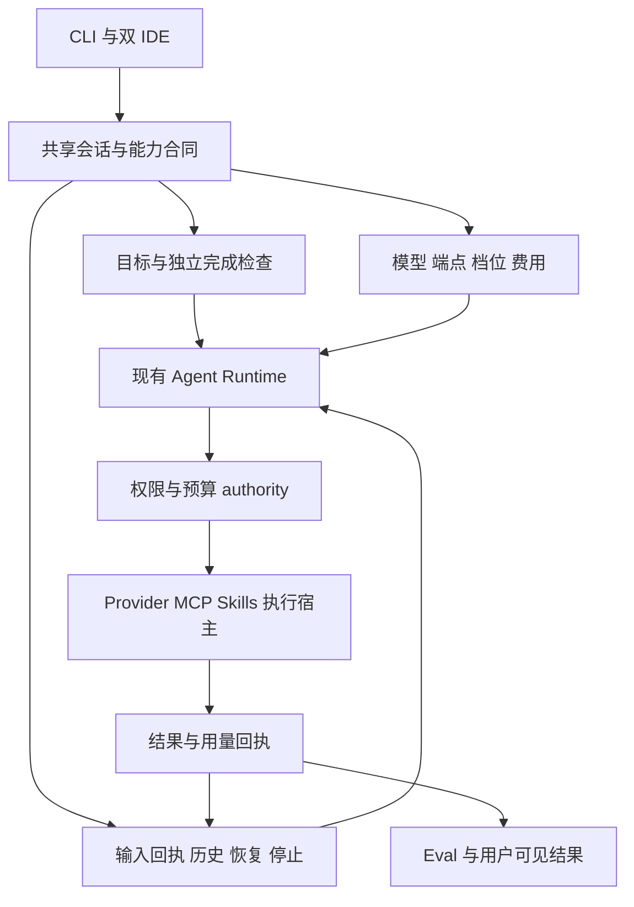
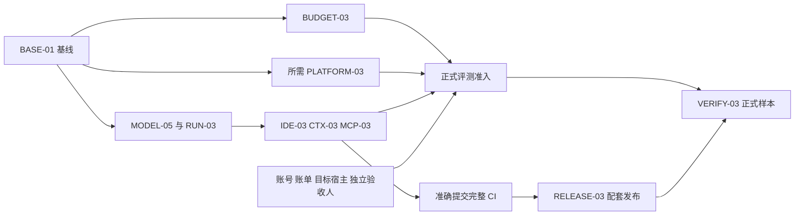

# ChainlessChain 借鉴 Codex 和 Claude Code 的实施计划

日期：2026-10-15。适用范围：CLI、共享 Agent Runtime、VS Code 和 JetBrains 插件。桌面端复用成熟后的共享能力；移动端、论坛和业务后端不纳入本轮改造。

建议未来八周优先投入六件事：**模型能力与费用同步更新、任务完成与恢复可靠、首次安装容易排障、上下文按需加载、扩展接入行为一致、真实任务有独立验收**。项目已经有较完整的 Agent、Skills、MCP、Memory 和 IDE 基础，下一阶段的收益主要来自把这些能力接成稳定的用户流程。

本计划承接 [CLI 差距分析](./cli/cli-claude-code-codex-gap-analysis-2026-10-05.md)和 [IDE 差距分析](./ide/ide-claude-code-codex-gap-analysis-2026-10-05.md)，同时按[后续实施记录](./cli-ide-gap-implementation-2026-10-05.md)、[验证记录](./cli-ide-gap-validation-2026-10-05.md)及当前源码调整任务。原报告正文是 10 月 5 日的审计快照，不能直接用作今天的未完成清单。

## 1 现状与本轮目标

### 1.1 实施基线

源码核对基线为 `6752b49e1e068c180a645e1e26773303bbb40648`。10 月 15 日工作区中的发布设计记录（`docs/design/release-runtime-update-2026-10-15.md`）记载 CLI `0.166.101`、Kernel `0.1.10`、Open VSX `0.37.145` 已公开；JetBrains `0.4.163` 仍是源码候选，公开记录为 `0.4.162`。该记录当时尚未提交，正式排期开始时应按 BASE-01 重新固定发布证据。

以下状态决定任务从哪里开始：

| 方向          | 当前可复用能力                                                                                        | 本轮工作                                                                 |
| ------------- | ----------------------------------------------------------------------------------------------------- | ------------------------------------------------------------------------ |
| 模型与定价    | GPT-6.1 Sol、Sonnet 5.5 已有精确 profile；当前源码也已有 Haiku 5.5；价格、reasoning、协议已有共享合同 | 增量维护速度档位、来源日期、网关差异及实际 usage，不重复增加已有模型     |
| 上游更新      | 已有 `Model Catalog Review`、定时审查和漂移报告                                                       | 补充能力字段变化审查，记录从发现到验证的处理时长                         |
| 任务恢复      | 输入接受回执、历史分页、压缩、重试和工作流终态均已有实现；`.101` 修复压缩拒绝后的结算与终态           | 验证跨入口组合场景，统一用户可见的完成、失败、停止和待核对状态           |
| IDE           | Doctor 能力诊断、严格 CLI 身份、120 秒有界初始化、草稿及恢复已实现                                    | 完成公开安装、升级、故障恢复及真人操作旅程                               |
| Skills 和 MCP | Skills 已分描述与正文两阶段加载；MCP 已有阈值工具搜索和发现缓存                                       | 优化选择准确率、默认上下文成本、失效与权限一致性                         |
| Memory        | 已有二级查询索引、过滤下推、稳定游标和重建                                                            | 建立固定硬件 SLO，再优化索引读取和重建成本                               |
| 外部 Codex    | 固定 `0.160.0` 的 schema 与真进程探针已存在                                                           | 更新兼容证据；协议通过与生产执行准入分别管理                             |
| 正式评测      | 36 项任务、9 次首次安装、setup/check 和采集器已有工程基础                                             | 原正式状态仍为 `NOT_RUN`；补齐准入条件后执行，保留固定分母               |
| 预算与平台    | 已有正式预算 authority、受守护传输及部分 native 原型                                                  | `paidReady:false`、完整 native `NOT_ADMITTED` 仍是实际边界；先补对应证据 |

### 1.2 值得学习的产品方法

1. **让完成条件成为任务的一部分。** 用户提出目标后，系统应展示产物、验证结果和剩余问题，持续执行有边界的工作。
2. **让一次任务贯穿 CLI 和 IDE。** 历史、草稿、审批、预算与停止状态由共享 runtime 决定，入口负责呈现与操作。
3. **把上下文作为有限资源管理。** 按任务加载技能、工具和文件，解释上下文与费用的主要来源。
4. **以真实能力决定选项。** 模型名、安装版本和账号权限分别核验，给出可执行的降级说明。
5. **把竞品修复转换为本项目的回归场景。** 优先寻找对应调用路径和复现条件，再决定是否修复或立项。
6. **用真实任务收益判断投入。** 重点看任务通过率、人工接管次数、费用、恢复成功率和首次成功时间。

## 2 最新官方资料带来的增量

官方资料核对日期为 2026-10-15。“最新”在这里指当日可读取的官方能力说明，客户端、模型、API 和 IDE 的版本分别处理。

| 官方信息                                                                                                        | 对本项目的启发                                                               | 对应任务                  |
| --------------------------------------------------------------------------------------------------------------- | ---------------------------------------------------------------------------- | ------------------------- |
| OpenAI 10 月 8 日发布 GPT-6.1 Sol Ultrafast；API 通过 `service_tier` 选择，产品订阅与 API 的可用条件不同        | 将模型、档位、端点、区域和账户可用性共同纳入合同，速度选项应显示相应费用状态 | MODEL-05                  |
| Codex App Server 文档包含持久 goal、分页历史、恢复和独立 session identity                                       | 将目标、终态和历史定位贯穿双 IDE；适配器按固定协议验证                       | RUN-03、IDE-03、COMPAT-03 |
| Codex Skills 文档强调按需加载与初始目录预算；官方提示工程文章建议缩短描述、按任务读取说明                       | 在现有延迟加载上完善目录排序、诊断和检索效果评估                             | CTX-03                    |
| Claude Code 官方 CHANGELOG 当前首项为 `2.1.299`，涉及闲时压缩、usage 提示、重启重复工具调用、队列和插件边界修复 | 借鉴成本提示与恢复负例；闲时压缩先做收益实验；权限相关项先做本项目复现       | RUN-03、CTX-03、MCP-03    |
| Claude MCP 文档描述工具按需发现及不同模型、网关的兼容边界                                                       | 现有工具搜索需结合端点能力、schema 版本和失效机制运行                        | MCP-03                    |
| Claude 最佳实践强调可执行完成检查，并将执行与结果复核分开                                                       | 复用已有完成条件引擎、Eval 和独立 checker，让任务结束有依据                  | RUN-03、VERIFY-03         |

来源：[OpenAI API 更新](https://developers.openai.com/api/docs/changelog)、[Ultrafast](https://developers.openai.com/api/docs/guides/ultrafast-mode)、[Codex 产品更新](https://learn.chatgpt.com/docs/changelog)、[App Server](https://learn.chatgpt.com/docs/app-server)、[Skills](https://learn.chatgpt.com/docs/build-skills)、[提示与技能改进](https://developers.openai.com/blog/rethinking-skills-and-prompts-for-gpt-6-astra)、[Claude 官方 CHANGELOG](https://raw.githubusercontent.com/anthropics/claude-code/main/CHANGELOG.md)、[Claude MCP](https://code.claude.com/docs/en/mcp)、[Claude 最佳实践](https://code.claude.com/docs/en/best-practices)。

版本边界：Claude `2.1.299` 是本次读取的官方变更日志首项，未核验各分发渠道同步情况。原 Codex changelog 地址已跳转到混合产品更新页，本次未从该页确认最新 CLI 补丁号；`0.160.0` 仅表示仓库当前固定探针版本。COMPAT-03 必须先确认目标发行及二进制身份，再更新测试版本。

## 3 架构与交付原则

继续使用现有共享 runtime。新增能力优先扩展已有模型 profile、会话事件、权限 authority、工具目录和验收器，控制独立状态来源的数量。

设计约束：

- 模型声明、账户可用、运行时支持和验收通过分别记录；未知费用继续显示 unknown/unpriced。
- 输入接受状态、执行结果和目标验收结果分别建模。会话读回不触发工具副作用，未知接受状态先核对。
- 执行权限在实际调用前校验，模型、插件描述、历史消息及界面状态均不能自行授予权限。
- 给新增字段加版本与能力协商。旧 CLI 保留已支持功能；无法确认的高级能力明确降级。
- 数据升级保留恢复路径。特别是 Memory 新索引格式可能被旧 reader 拒绝，回滚需要兼容 reader 或备份恢复。

## 4 工作包与验收条件

下列 ID 是本轮计划项；括号中标明与旧报告的关系。人日为工程估算，包含定向回归与文档，不含市场审批、账号开通和长时运行的等待。负责人使用角色，启动时落实到具体人员。

### BASE-01 固定当前能力和发布基线

**优先级：P1；负责人：技术负责人和 QA；工作量：2～3 人日。**

整理一份可机器读取的能力清单，关联源码 SHA、CLI 与子包版本、IDE 版本、OS/架构、执行位置、验证类型和证据路径。复用现有发布回读及执行位置合同，并让旧问题 ID 指向现有实现或后续任务。

验收：

- MODEL-03、MODEL-04、PERF-03、IDE-READY-02、IDE-ONBOARD-02、IDE-COLD-02 标记为已有实现并附剩余验证项。
- 明确公开版本、源码候选和市场待审状态；记录当前 36+9、预算和 native 准入状态。
- 后续每个工作包有确定基线，允许按能力交付；发布状态不会自动关闭产品验收。

### MODEL-05 模型与服务档位统一维护

**优先级：P1；负责人：Runtime 工程师；工作量：5～7 人日；承接 MODEL-03 和 MODEL-04。**

当前 `model-context-catalog.js` 的目录日期仍为 `2026-10-05`，GPT-6 共用 `serviceMultipliers` 尚未列出 `ultrafast`；`llm-pricing.js` 对不认识的档位返回未定价。这是需要补充的能力，现有代码没有证明该档位已被错误按标准价收费。

实施步骤：

1. 在现有 profile 上补充逐型号、逐档位的能力和定价来源，记录 `reviewedAt`、端点范围和未知字段；先核实价格表达是否能由现有倍率准确表示。
2. 将上游审查从版本变化扩展到协议、档位、上下文、缓存、区域和退役字段，输出待审差异与负责人。
3. 串联配置、请求生成、预算预留、usage 结算和双 IDE 显示，保留 requested/effective 档位；以响应证据确定实际结算。
4. 官方端点与自定义网关分别建立合同。按用户配置显式降级或返回错误，避免静默换模型或变更费用档位。

验收：不支持档位在发出请求前给出准确原因；未知价格不能显示为免费；计费、预算、Eval 与 UI 对同一请求一致。真实官方 stream/tool/reasoning 和账单在授权账号下另行验证。

### RUN-03 将目标执行与恢复接成完整流程

**优先级：P1；负责人：Runtime 工程师；工作量：7～10 人日；承接恢复和压缩修复。**

复用 `goal-condition-engine.js`、`workflow-engine.js`、`session-input-receipt.js` 和现有会话存储。完成条件支持确定性检查和独立评价；默认工程任务优先使用测试、构建或产物检查。长期 OKR 与会话完成条件保持各自语义。

实施步骤：

1. 将目标、检查结果、预算和剩余步骤投影到 CLI 与 Workbench，保留现有事件身份。
2. 对齐停止当前轮、停止指定后台任务和停止整个工作流的范围；结果里保留未完成工作与最后可靠检查点。
3. 统一恢复顺序：读取持久状态、核对输入接受回执、恢复有效权限与预算、确认未决副作用，再接受后续输入。
4. 覆盖压缩失败但已经计费、提交未知、断流已输出正文、工具执行后响应丢失、重启同时收到新输入等组合场景。

验收：失败压缩不会把任务标为完成；已知用量只结算一次；未知提交进入待核对状态；没有确认未接受时不自动补发。CLI 和两个 IDE 对同一任务展示相同结果，冻结故障场景无重复副作用。

### IDE-03 优化首次成功与故障恢复

**优先级：P1；负责人：IDE 工程师；工作量：5～7 人日；承接三项 IDE 修复。**

以“安装插件 → 找到正确 CLI → 配置 provider → 完成首次任务 → 查看变更与验证 → 重启继续”为主旅程。复用 Doctor、onboarding、草稿、流式 transcript、Plan/Diff/Review 和 Sessions Workbench。

实施步骤：

1. 在同一位置展示实际 CLI 身份、版本配对、运行位置、模型可用性和能力降级原因，提供对应修复动作。
2. 启动等待显示当前阶段和可停止状态；超时、进程退出、凭据错误和端点不支持分别提示。
3. 提交后明确区分排队、已接受、运行、待审批、停止、失败、完成和待核对；保留问题与审批的结果。
4. 将上下文附件、诊断、产物和验证入口整合到任务视图。用户滚动阅读时保持选区和位置，错误与恢复操作支持键盘访问。

验收：无 CLI、同名 GCC、错误显式路径、旧版降级、30 秒迟到 init、永不 init、提前退出、reload、最后标签关闭等场景均有正确结果。干净 profile 和公开安装产物完成九入口旅程；真人辅助技术验收单独记录。

### CTX-03 衡量并降低无关上下文

**优先级：P1；负责人：Runtime 工程师；工作量：5～8 人日；扩展既有 Skills 和上下文工程。**

Skills 的正文延迟读取与预算已存在，本项重点是让加载决策有效且可解释。MCP 部分与 MCP-03 共用测量口径。

实施步骤：

1. 利用现有 context source ledger 展示系统说明、项目规则、技能目录、工具 schema、历史、附件和 Memory 的占用来源；估算值和真实 usage 分别标记。
2. 审查高频内置技能描述，缩小触发范围，将长流程拆成按需引用；保持显式技能调用和权限要求完整。
3. 对 50、200、500 个技能及大型 MCP 目录测试目录裁剪、检索命中、正文加载时机和错误调用率；被省略内容可搜索、可提示。
4. 保留压缩前后的目标、用户约束、未决审批、关键证据和恢复身份。用中文、代码、emoji、长工具输出及图片任务评估事实保留。
5. 闲时压缩列为实验开关：先估算摘要费用、缓存收益、离开时长及恢复质量，在可核算预算内验证后决定是否启用。

验收：固定任务集上比较默认上下文、请求数、费用与通过率；上下文变小同时必须保持关键约束和权限语义。目录中保留成本提示，失败压缩不替换原有效 head。自动闲时压缩不作为本轮默认行为。

### MCP-03 统一扩展发现与执行边界

**优先级：P1；负责人：Runtime 工程师；工作量：4～6 人日；承接 MCP-02。**

复用 `mcp-tool-search.js`、`mcp-client.js` 和 `plugin-runtime/`，聚焦既有工具搜索、缓存、重载、策略检查与执行的组合行为。

实施步骤：

1. 核验延迟 schema 在各 provider 路径上的实际可调用性，将连接失败、未授权和无匹配结果区分显示。
2. 缓存绑定 server、工具 schema、能力和策略版本；服务器变更或撤销权限后，旧会话中的描述不能继续授予执行能力。
3. 将上游特殊工具名、插件禁用后残留、动态新增 server、挂起通知正文、日志背压等问题转换为针对本项目的负向场景。
4. 保持结果未知时不重放；受限调用在启动服务器或发送网络请求前完成策略检查。

验收：stdio、HTTP、SSE、取消、重连、热重载、策略变更具有一致结果；被拒绝的连接没有实际启动或网络副作用；大输出和日志阻塞能有界终止。外部 OAuth 账号另按目标服务验收。

### BUDGET-03 完成正式评测的费用约束

**优先级：P0 前置门，仅用于正式付费评测与相应支持声明；负责人：Runtime 和平台工程师；工作量：10～15 人日，宿主隔离另计。**

当前 `formal-budget-transport.js` 明确列出 Agent、Chat、压缩、Advisor、探针、重试及子进程出口尚未全部覆盖。本项复用正式预算 authority，先明确覆盖范围，再逐出口接入。

实施步骤：

1. 建立请求入口清单与调用链，确保每次付费尝试先预留、后调用、再按可信 usage 结算；压缩和重试进入同一预算。
2. 约束同一评测计划的预算谱系唯一性，覆盖数据库复制、回滚、并发进程、异常退出及恢复。
3. 将凭据与 authority 放在受信任宿主内，验证任务进程和后代无法绕过受控出口。宿主要求与 PLATFORM-03 联合验收。
4. 固定账户价格、币种换算、输入及输出上界和评测窗口；未知账单保留未决预留，暂停后续请求。

验收：重复回执不重复结算；两个并发进程不能各自花完整预算；跨库复制与回滚不能生成额外额度；断线、压缩拒绝和 Stop 后的账本可恢复。全部目标出口和宿主组合通过后，才能调整对应范围的 `paidReady`。

原冻结计划的共享 **$99** 是历史总上限，不能重置为新预算或拆成每次运行各 $99。执行前须核对历史已消费和未决费用；本计划不构成新增付费调用授权。

### PERF-04 将性能数据变成可执行目标

**优先级：P2；负责人：Runtime 工程师和 QA；工作量：4～6 人日；承接 PERF-03。**

Memory 索引已完成，已有测量显示热查询仍要校验索引字节。先按 1K、10K、100K 数据和固定硬件建立基线，再决定是否分段验证、缓存已验证页或调整索引布局。

同时测量 IDE 冷启动、历史分页、长流式响应、Stop 和内存趋势。查询结果、排序和 CAS 一致性是前置条件，性能优化不能放宽损坏检测或读旧权限。

验收：完整报告冷、热、重建、并发写删和损坏恢复；与全量扫描比较相同结果摘要。任何缓存绑定 authority/generation，失效后重新验证；数据回滚路径经过演练。SLO 达标才宣布性能目标完成。

### VERIFY-03 用正式任务检验产品收益

**优先级：P1；负责人：QA 和独立验收人；工作量：8～12 人日，不含外部等待；承接 VERIFY-02 和 VERIFY-IDE-02。**

复用冻结 36 项任务、9 次首次安装及现有 setup/check、IDE prepare/finish、outcome schema。新增竞品回归属于独立工程集，不能加入正式分母替代未运行样本。

执行顺序：

1. 检查验收器独立性、冻结源码和任务规格，保留历史反例及失败证据。
2. 完成账号、目标九入口、公开包身份、预算、宿主和独立人工审阅的准入核对。
3. 从冻结样本中选择少量代表任务先执行，合格后继续剩余任务；已经执行的样本仍归原分母，不额外计数。
4. 采集实际产物、测试、终态、重试、人工接管及逐请求费用，独立判断任务是否达标。
5. 按支持范围安排真实 8h/24h 活跃负载观察、恢复演练和 NVDA/VoiceOver/Orca 听测。

验收：报告固定展示完成数、通过数、失败数、阻塞数和未运行数；区分执行成功与验收通过。对同一任务比较改造前后成本和接管次数，禁止由小样本或测试数量推出超过竞品的结论。缺准入条件时保留 `NOT_RUN` 或相应部分执行状态。

### RELEASE-03 以准确提交完成配套交付

**优先级：P0 发布前置门；负责人：发布负责人；工作量：2～3 人日加工作流等待。**

遵守仓库 AGENTS.md：相关子包先发布并可获取，再发布 CLI，最后发布 IDE。所有 npm 发布使用 GitHub Actions OIDC Trusted Publishing。

验收：候选准确 commit 的 `CLI CI` 与 `CLI Strict Sandbox` 在全部配置系统通过，其他相关发布门按工作流执行；任意修复后的新提交重新验证。每阶段核对版本依赖、制品摘要、可获取性和来源；IDE 市场提交与公开可安装分别记录。不得用旧 SHA、本地测试或不完整矩阵替代。

### 条件工作包

| ID                                 | 优先级与估算                                                                  | 启动条件                                                          | 交付边界                                                                                   |
| ---------------------------------- | ----------------------------------------------------------------------------- | ----------------------------------------------------------------- | ------------------------------------------------------------------------------------------ |
| COMPAT-03 外部 Agent 协议持续兼容  | P2，3～5 人日                                                                 | 选定可核验的上游版本与真实二进制                                  | 更新 schema、真实进程、交错 thread、分页、恢复和取消测试；生产准入仍要求逐请求治理         |
| PLATFORM-03 单平台 native 正式交付 | 扩大支持或执行依赖它的正式样本前为 P0；首个平台约 20～40 人日，原型评审后重估 | 明确首个平台、目标硬件、可信服务和隔离方案                        | 完成存储、journal、防回滚、网络撤销、后代回收和 broker 崩溃恢复；Windows 与 macOS 分别验收 |
| CLOUD-03 本地与云端连续任务        | P2，先用 3～5 人日验证方案                                                    | 至少有明确的断开 IDE 持续运行或跨机器接续需求，预算与权限方案成立 | 复用现有 handoff，验证会话身份、租约、审批归属、取消和产物回流；完整开发另估               |

完整 native 能力若是冻结任务的必需条件，PLATFORM-03 即进入正式评测关键路径。不能通过改任务、缩小原分母或把容器结果代入 native 样本规避该依赖。

## 5 排期与资源

建议以 **3 名工程师加 0.5 名 QA** 为规划容量，工程师分别主责 Runtime、IDE、平台与集成；这是假设配置，启动时据实际人手调整。核心十项合计 **52～77 人日**，再留约 20% 缓冲；条件工作包单独计入。单人顺序实施宜按约 14～20 周准备，外部等待另计。

若 2026-10-19 启动，八周安排如下。工程可交付时间与正式验收完成时间分别管理。

| 阶段       | 建议日期       | 主工作                                                      | 阶段出口                                                         |
| ---------- | -------------- | ----------------------------------------------------------- | ---------------------------------------------------------------- |
| 第 1～2 周 | 10-19 至 10-30 | BASE-01、MODEL-05、RUN-03；BUDGET-03 入口清单与平台依赖评审 | 固定基线；模型档位合同；终态与恢复反例；正式评测阻塞项有负责人   |
| 第 3～4 周 | 11-02 至 11-13 | IDE-03、CTX-03、MCP-03；继续预算接线                        | 双 IDE 连贯主旅程；上下文占用报告；扩展策略回归；预算覆盖清单    |
| 第 5～6 周 | 11-16 至 11-27 | PERF-04、VERIFY-03 验收准备；预算与宿主联合检查             | 固定硬件基线和 SLO；正式评测逐项准入决定；必要的平台延期明确可见 |
| 第 7～8 周 | 11-30 至 12-11 | 满足条件的真实验收、长时观察、RELEASE-03                    | 配套工程版本及真实结果报告；未满足条件的正式样本保留开放         |

关键依赖：

工程版本可以按实际支持范围交付；正式评测受预算、native、账号或人工条件阻塞时，不把第八周写成全部完成。每周更新阻塞责任与下一步，同时继续不依赖该条件的已授权工程工作。

## 6 验证指标与质量门

下表是建议目标，不是当前成绩。BASE-01 阶段固定硬件、负载、网络、采样方式和阈值后才成为 gate；如历史冻结方案已有阈值，沿用原值并单独提出变更理由。

| 指标         | 建议验收口径                                                                                              |
| ------------ | --------------------------------------------------------------------------------------------------------- |
| 恢复正确性   | 冻结故障矩阵中重复副作用 0、错误完成 0、用户草稿丢失 0；并覆盖重启与乱序                                  |
| 费用一致性   | 同一请求的 CLI、IDE、预算与 Eval 口径一致；重复回执不增账；未知用量明确未决                               |
| 首次使用     | 九个冻结入口全部有实际结果；另测从插件可用到首次任务完成的中位数、p95 和人工步骤，账号等待单列            |
| 模型更新     | 建议官方变化 2 个工作日内形成差异记录，5 个工作日内给出支持、实验或延期决定；不承诺五天内通过所有真实验收 |
| 上下文效率   | 200 技能与固定 MCP 集合下，默认元数据输入目标比基线减少 30%；关键约束全保留，工具选择与任务通过率不得下降 |
| IDE 本地交互 | 建议输入与滚动响应 p95 ≤100ms、Stop 本地反馈 ≤500ms；实际进程停止另受后端合同约束                         |
| Memory       | 100K 固定查询热路径 p95 目标较基线改善至少 30%；冷启动、重建和 RSS 同时报告                               |
| 真实任务     | 固定 36 项和 9 次安装逐项记录；成功任务均有独立 checker/产物证据，报告人工接管和成本                      |
| 长时运行     | 8h/24h 活跃负载有心跳、工作记录、故障注入和结束检查；进程存在或空闲等待不能单独证明稳定                   |

验证分四层：纯函数和状态机合同、真实进程及协议、真实 IDE/OS 宿主、正式 provider 与真人旅程。每一层只证明自己的范围。重要负例包括预算耗尽、未知 usage、网络断开、进程崩溃、迟到 ACK、权限撤销、索引损坏和扩展重载。

## 7 前十个工作日的交付清单

| 时间        | 具体交付                                                   | 建议提交主题                                             |
| ----------- | ---------------------------------------------------------- | -------------------------------------------------------- |
| 第 1～2 天  | 基线能力清单、旧 ID 映射、发布证据、条件依赖负责人         | `docs(cli): establish runtime capability baseline`       |
| 第 3～4 天  | 档位差异 fixture、未知定价负例、profile 字段与 UI 展示合同 | `feat(cli): extend reviewed model tier contracts`        |
| 第 3～5 天  | 现有终态与回执路径清单、组合故障重现及修复                 | `fix(runtime): reconcile interrupted task outcomes`      |
| 第 5～7 天  | 双 IDE 展示目标、检查结果和恢复原因的首个贯通旅程          | `feat(ide): expose task verification and recovery state` |
| 第 6～8 天  | 上下文来源基线与技能/MCP 检索任务集                        | `test(cli): baseline context loading effectiveness`      |
| 第 8～10 天 | 预算全部调用入口审查、宿主缺口与准入决定；一次完整开发演示 | `test(cli): verify governed provider entry points`       |

建议每个 PR 聚焦一个可审查行为，并填写相关验证结果。工作按仓库要求使用 `feature/*` 分支和 PR；新增产品改动不与历史发布记录的整理混在一个提交里。

## 8 关键实施入口

以下路径均为现有入口，新增测试优先补到对应合同和真实旅程中。

| 工作包          | 主要文件或目录                                                                                                                                                                                                                                                                                                                                                         |
| --------------- | ---------------------------------------------------------------------------------------------------------------------------------------------------------------------------------------------------------------------------------------------------------------------------------------------------------------------------------------------------------------------- |
| 模型和费用      | [model-context-catalog.js](../../packages/cli/src/lib/model-context-catalog.js)、[model-capabilities.js](../../packages/cli/src/lib/model-capabilities.js)、[llm-pricing.js](../../packages/cli/src/lib/llm-pricing.js)、[model-catalog-review.js](../../packages/cli/src/lib/model-catalog-review.js)、[审查工作流](../../.github/workflows/model-catalog-review.yml) |
| 目标和恢复      | [goal-condition-engine.js](../../packages/cli/src/lib/goal-condition-engine.js)、[workflow-engine.js](../../packages/cli/src/lib/workflow-engine.js)、[session-input-receipt.js](../../packages/cli/src/lib/session-input-receipt.js)、[agent-core.js](../../packages/cli/src/runtime/agent-core.js)                                                                   |
| Skills 和上下文 | [skill-loader.js](../../packages/cli/src/lib/skill-loader.js)、[skill-budget.js](../../packages/cli/src/lib/skill-budget.js)、[cli-context-engineering.js](../../packages/cli/src/lib/cli-context-engineering.js)、[context-source-ledger.js](../../packages/cli/src/lib/context-source-ledger.js)                                                                     |
| MCP 和插件      | [mcp-tool-search.js](../../packages/cli/src/runtime/mcp-tool-search.js)、[mcp-client.js](../../packages/cli/src/harness/mcp-client.js)、[plugin-runtime](../../packages/cli/src/lib/plugin-runtime/)                                                                                                                                                                   |
| 正式预算        | [formal-budget-authority.js](../../packages/cli/src/lib/formal-budget-authority.js)、[formal-budget-transport.js](../../packages/cli/src/lib/formal-budget-transport.js)、[formal-budget-contract.js](../../packages/cli/src/lib/formal-budget-contract.js)                                                                                                            |
| VS Code         | [ide-doctor.js](../../packages/vscode-extension/src/ide-doctor.js)、[chat](../../packages/vscode-extension/src/chat/)、[sessions-workbench.js](../../packages/vscode-extension/src/sessions-workbench.js)                                                                                                                                                              |
| JetBrains       | [AgentChatSession.java](../../packages/jetbrains-plugin/src/main/java/com/chainlesschain/ide/AgentChatSession.java)、[IdeDoctor.java](../../packages/jetbrains-plugin/src/main/java/com/chainlesschain/ide/IdeDoctor.java)、[ConversationView.java](../../packages/jetbrains-plugin/src/main/java/com/chainlesschain/ide/intellij/ConversationView.java)               |
| Memory          | [memory-query-index.js](../../packages/cli/src/lib/context-memory-kernel/memory-query-index.js)、[memory-service.js](../../packages/cli/src/lib/context-memory-kernel/memory-service.js)                                                                                                                                                                               |
| Eval 和平台     | [eval](../../packages/cli/src/lib/eval/)、[execution-location-contract.js](../../packages/cli/src/lib/execution-location-contract.js)、[Codex 协议工作流](../../.github/workflows/codex-app-server-compatibility.yml)                                                                                                                                                  |

## 9 投入取舍与后续方向

本期优先复用现有 Plan、Diff、Review、Workbench 和执行宿主。Bookmarks、语音、主题、完整 Mods UI 及自动云端迁移放入需求池，由真实使用反馈决定顺序。平台权限问题按具体支持组合解决，避免一次承诺所有 OS 和运行位置。

ChainlessChain 可以在这一基础上发挥已有的多 provider、本地模型、私有知识和团队权限能力：让同一项任务在明确的隐私范围、执行位置与费用预算下完成。后续模型路由和知识复用实验，应以任务通过率及总成本验证收益；未经验证的学习结果继续保留现有晋升控制。

八周工程阶段的交付应包括配套能力、准确状态、回归证据和可复现的体验报告。正式 36+9、完整 native、账单及真人长时验收各自达到条件后结案，持续保留未完成项及责任人。
